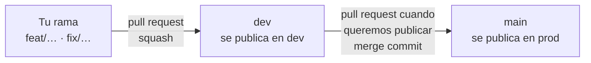

# Cómo trabajamos

Acuerdos del equipo para el repo del Club (la marca blanca y la copia de cada cafetería). Si algo cambia, se cambia acá.

## Ramas



| Rama | Qué es | Se publica en |
|---|---|---|
| `main` | Lo que está en producción | **prod**, al fusionar |
| `dev` | Lo que está listo para probar | **dev**, al fusionar |
| Tu rama | Un cambio en curso | Ningún lado: solo se revisa |

- **Nadie sube directo a `dev` ni a `main`:** todo entra por pull request.
- Cada cambio va en su propia rama, **salida de `dev`**, con un nombre corto que diga qué es:
  - `diseno/…` para diseño y documentos (`diseno/billetera-noche`)
  - `feat/…` para funcionalidad nueva (`feat/sumar-sello`)
  - `fix/…` para arreglos (`fix/codigo-sin-conexion`)
  - `infra/…` para CI, dominio y configuración (`infra/ci-pull-requests`)
- Las ramas se borran después de fusionarlas (`dev` y `main` nunca).

## Pull requests

**De tu rama a `dev`** (el día a día):
1. Abrir el pull request **contra `dev`** y completar la plantilla.
2. Esperar la CI en verde.
3. **El otro desarrollador lo revisa y lo aprueba.** Nadie fusiona su propio pull request sin el visto bueno del otro.
4. Fusionar con ***Squash and merge***: cada cambio queda como un solo commit en `dev`.
5. Se publica solo en dev: probarlo en el celular en la dirección de dev de la cafetería (`https://club-dev.<cuenta>.workers.dev`).

**De `dev` a `main`** (cuando decidimos publicar en prod):
1. Abrir el pull request de `dev` contra `main`, con la lista de lo que entra.
2. Esperar la CI en verde y el visto bueno del otro.
3. Fusionar con ***Create a merge commit*** (no squash): así `dev` y `main` comparten historia y el próximo pull request no arrastra cambios viejos.
4. Se publica solo en prod.

**Un arreglo urgente en prod** va igual: rama desde `dev`, pull request a `dev` y, enseguida, de `dev` a `main`.

Un pull request hace una sola cosa. Si toca diseño y código, mejor dos.

## Commits

- En español, en presente y empezando con mayúscula: *Agregar la pantalla de sumar sello*, *Corregir el contador al deshacer*.
- La primera línea, de 72 caracteres como máximo. Si hace falta, el detalle va en el cuerpo.

## Secretos y datos personales

- Nunca se suben al repo claves, tokens ni archivos `.env` (el `.gitignore` los excluye).
- Para desarrollar, se copia `.dev.vars.example` a `.dev.vars`, con claves de prueba. Las claves reales viven en Bitwarden y en Cloudflare (ver [`docs/implementacion/entorno.md`](docs/implementacion/entorno.md)).
- Nunca se suben datos reales de clientes, ni siquiera para pruebas: se usan datos inventados (*Marta García, 30.123.456*).
- La clave del hash del DNI vive solo en los secretos de Cloudflare y en el gestor de contraseñas del proyecto.

## Estructura

```
club/
├── app/              ← el código: cliente, caja y panel en la misma app (React Router 7)
│   ├── src/cafes/        ← la configuración de cada cafetería (nombre, Club, tarjetas, textos)
│   └── public/brand/, public/stamps/   ← los logos y los sellos de la cafetería
├── docs/             ← spec y flujos
│   └── implementacion/   ← decisiones técnicas, entorno, CI/CD, dominio
├── marca/            ← la puesta en marcha, el tema (tokens.json) y las guías de interfaz, movimiento y voz
├── .claude/          ← configuración de Claude Code: permisos, skills, hook de inicio
├── .github/          ← CI/CD, Dependabot y plantillas
├── CLAUDE.md
├── CONTRIBUTING.md
└── README.md
```

Al mover un archivo, se actualizan los enlaces que apuntan a él.

## Decisiones

Las decisiones de diseño viven en el spec y en los flujos; las técnicas, en [`docs/implementacion/`](docs/implementacion/). Cuando se cierra una, se anota con la fecha en la tabla *Decisiones* de [`docs/implementacion/README.md`](docs/implementacion/README.md).
