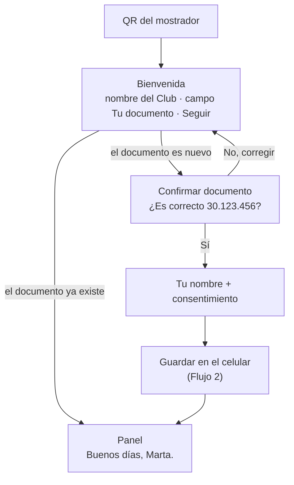
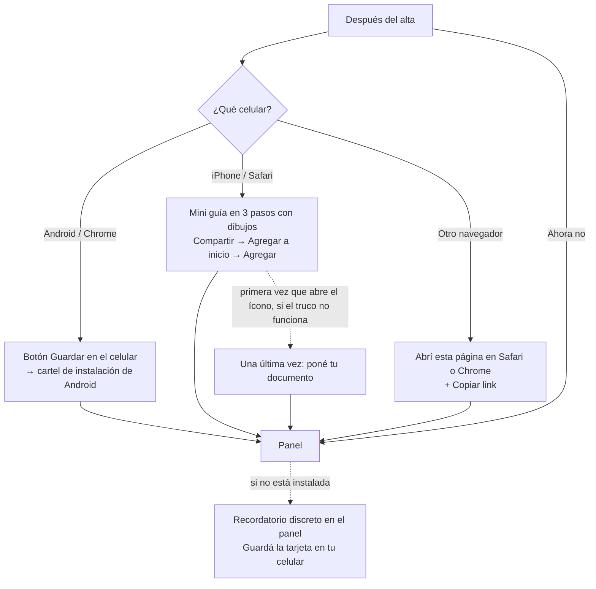
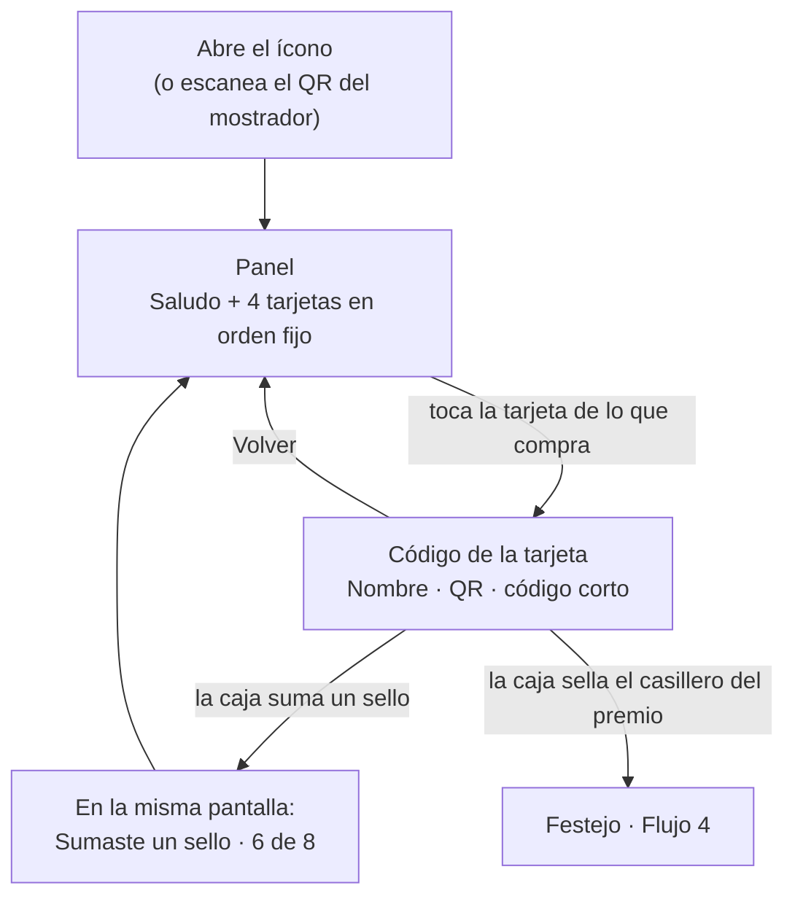

# Flujos del cliente

> Documento de diseño. Define qué hace el cliente en la app del Club, pantalla por pantalla. Los nombres, premios y textos propios de ejemplo son los de la cafetería de ejemplo (`app/src/cafes/example.ts`).
> Fecha: 01/10/2026 · Actualizado: 03/10/2026
> Base: [spec](propuestas-tarjeta-fidelizacion.md) (Propuesta A, cuenta por DNI) y las guías de [interfaz](../marca/interfaz.md) y [voz](../marca/voz.md).

## Decisiones tomadas

| Tema | Decisión |
|---|---|
| Entrada | Una sola pantalla de bienvenida con el campo de documento. El sistema decide si entra (ya existe) o lo anota (es nuevo) |
| Confirmar el DNI | Solo en el alta: "¿Es correcto 30.123.456?" |
| Datos que se piden | Documento y nombre. Sin mail ni teléfono por ahora |
| Instalar en el celular | Mini guía después del alta (se puede saltear) y un recordatorio discreto en el panel hasta que la instale |
| Elegir la tarjeta | La elige el cliente; cada tarjeta tiene su propio QR |
| El código de cada tarjeta | Fijo: no cambia nunca, se muestra sin conexión y no lleva el documento |
| Orden de las tarjetas | Fijo: Café take-away, Café en grano ¼ kg, Café en grano ½ kg, Café en grano 1 kg |
| Sello en vivo | Sí: la pantalla del código se actualiza sola cuando la caja suma |
| Premios | Se acumulan. Al completar la tarjeta, queda llena (todos los sellos y el premio ganado) hasta que se canjea el premio o se suma el primer sello de la vuelta nueva. Se sigue sumando aunque haya premios sin canjear |
| Canjear un premio | No suma sello |
| Palabra para el premio | "Canjear" (no "usar") |
| Vencimiento | Los sellos y los premios no vencen |
| Varias personas en un celular | No se contempla. Hay un botón *Salir* normal |
| Primera salida | Todos los flujos de este documento, junto con una caja mínima del lado del equipo |

---

## Flujo 1 · Entrar o anotarse



**Bienvenida.** Arriba el sello circular de la cafetería, el nombre del Club y la línea de bienvenida de la cafetería (*Cada visita suma un sello. Juntá los sellos y ganá tu premio.*). Debajo, el campo **Tu número de documento** (teclado numérico) y el botón **Seguir**. Al pie, el enlace *No tengo DNI argentino*, que deja elegir otro tipo de documento.

**Confirmar documento** (solo en el alta). Una hoja que sube desde abajo sobre la bienvenida, con el fondo oscurecido. El número grande, con puntos: **30.123.456**, y dos botones: **Sí, es correcto** y *Corregir*. Evita crear una cuenta con un documento mal tipeado. *Corregir* cierra la hoja y deja el número en el campo para arreglarlo.

**Tu nombre y consentimiento.** El campo **¿Cómo te llamás?** (*Así te saludamos cuando venís*) y una casilla: *Guardamos tu nombre y tu documento solo para el Club. No los compartimos con nadie.* También un enlace *Más información* y el botón **Anotarme**, que lleva directo a sus tarjetas: no hay pantalla intermedia.

## Flujo 2 · Guardar en el celular



- En **Android**, el botón abre el cartel de instalación del sistema. En **iPhone** no hay cartel automático: la única forma es la mini guía.
- La mini guía muestra **un paso por pantalla**, con el dibujo real del botón Compartir de Apple, e indica dónde está en la pantalla del teléfono (abajo, en el centro).
- El último paso del iPhone avisa: *La primera vez que abras el ícono, quizás te pidamos el documento una vez más.*
- **Recordatorio en el panel:** una línea al final del panel, nunca una ventana que tape: *Guardá la tarjeta en tu celular y abrila como cualquier app → Ver cómo*. Desaparece cuando la app se abre instalada. Si la persona lo cierra, no vuelve a aparecer en esa visita.
- **Pendiente técnico:** probar en un iPhone real si el código de un solo uso evita volver a pedir el documento. Si funciona, la pantalla "Una última vez" no aparece nunca.

## Flujo 3 · El uso de todos los días



- **Dos toques:** abrir y elegir la tarjeta.
- **Panel:** el saludo según la hora y con el nombre, sin el apellido (*Buenos días, Marta.*; *Buenas tardes* / *Buenas noches*). Abajo, las tarjetas de la cafetería en orden fijo (en la de ejemplo: **Café take-away**, **Café en grano ¼ kg**, **½ kg** y **1 kg**). Cada una muestra su nombre, *5 de 8*, la grilla con los sellos y el casillero del premio al final, como en papel (18/10/2026), y debajo la franja con la regla, corta (*El 8º café, gratis*, 19/10/2026): apagada, o iluminada con un aura mientras hay uno para canjear (10/10/2026). Arriba a la derecha, en lugar del logo de la cafetería, una etiqueta con el dibujo del premio y cuántos tiene, con la misma aura que el premio, que se ve también cuando la tarjeta está detrás; sin premios, no hay etiqueta (13/10/2026). El premio se usa en la compra siguiente al 7º sello (el 4º en grano), sellando el último casillero, y lo ofrece la caja al escanear. Van como en una billetera: la de adelante, completa; las otras asoman detrás y, al tocarlas, pasan adelante deslizándose, como en la billetera del iPhone. Al pie, el recordatorio de instalación (si corresponde) y **Salir**.
- **El código de la tarjeta:** una sola pantalla para el mostrador, se abra con *Ver mi código* o tocando la tarjeta de adelante (09/10/2026; antes eran dos, *Ver mi código* y *Detalles*). Arriba, el encabezado con el logo. Debajo, la tarjeta en su color con el nombre bien grande (para no mostrar la equivocada), *5 de 8 sellos*, la fila de casilleros (con el del premio al final), el QR, el código corto y la ayuda *Si no lo lee, subí el brillo o dictale el código*. Nada más: es lo que se le muestra al barista. Abajo, fijo y al alcance del pulgar, **← Volver a mis tarjetas**.
- **Encabezado:** en la billetera y en el código, arriba y fijo al bajar: el logo de la cafetería (tocarlo vuelve al inicio, la billetera). **Salir** solo en la billetera.
- **Tus sellos y premios:** su propia pantalla, desde el enlace *Ver mis sellos y premios* debajo de la tarjeta, que aparece cuando ya hay alguno. Todos, hasta 20, del más nuevo al más viejo: *Sumaste un sello* o *Canjeaste un premio*, con la fecha (*Hoy, 9:42*, *Ayer, 9:42*, *30 de septiembre, 9:42*; con el año si es otro). Lo que la caja deshizo no aparece, ni el deshacer: para el cliente no pasó. Tampoco dice quién lo hizo: eso queda en la ficha del equipo. Si no hay ninguno: *Todavía no sumaste sellos en esta tarjeta. Mostrale el código de tu tarjeta al barista cuando compres.* Abajo, **← Volver a la tarjeta**.
- **Sello en vivo:** mientras el código o sus sellos y premios están abiertos, la pantalla se actualiza sola. Cuando la caja suma, el nuevo sello se "imprime" en la fila y aparece *Sumaste un sello · 6 de 8*. El cliente no toca nada. La lista de sellos y premios también se actualiza sola.

## Flujo 4 · Completar la tarjeta y canjear el premio

```mermaid
flowchart TD
  C[Código de la tarjeta] -->|la caja suma el 7º sello (el 4º en grano)| L["Sumaste un sello · 7 de 8<br/>el casillero del premio se ilumina"]
  L -->|próxima visita| C2[Código de la misma tarjeta]
  C2 -->|la caja elige Canjear premio:<br/>sella el casillero del premio| F["Festejo<br/>¡Completaste la tarjeta!"]
  F -->|Seguir| P["Panel<br/>0 de 8 · la tarjeta vuelve a empezar"]
  C2 -->|la caja elige Sumar sello y guardarlo| G["1 de 8<br/>el premio queda guardado"]
```

**Reglas:**
- Como en papel (18/10/2026): con el 7º sello (el 4º en grano) el cliente gana el premio y el último casillero se ilumina. **Sellar ese casillero es canjear el premio**: la tarjeta se completa, el cliente ve el festejo y el contador vuelve a **0**. El 7º sello no tiene festejo.
- **El premio se puede guardar** (*Sumar sello y guardarlo* en la caja): arranca la vuelta siguiente y el premio queda guardado. Los premios **se acumulan**.
- **Canjear no suma sello.** Si el 8º café es gratis, ese café no cuenta para la vuelta siguiente.
- Para canjear, el cliente muestra **el mismo código**. No hay pantalla ni botón especial del lado del cliente: el barista elige *Canjear premio* en la caja.

**Textos:**

| Momento | Café take-away | Café en grano (¼, ½ o 1 kg) |
|---|---|---|
| La franja (siempre) | *El 8º café, gratis* | *En la 5ª compra, 30% OFF* |
| Premio en el panel | La tarjeta queda en *7 de 8*: el casillero *Gratis* y la franja se iluminan | La tarjeta queda en *4 de 5*: el casillero *30%* y la franja se iluminan |
| Festejo, al sellar el casillero del premio | **¡Completaste la tarjeta!** Este café va por cuenta de la casa. Que lo disfrutes, Marta. | **¡Completaste la tarjeta!** 30% OFF en tu bolsa de ¼ kg. Que la disfrutes. |
| Premio guardado | En la esquina de la tarjeta, el dibujo del premio y cuántos tiene | Igual |

Estos textos son de la configuración de cada cafetería (`texts` de cada tarjeta): pueden llevar su guiño.

## Flujo 5 · Casos fuera del camino

| Situación | Qué ve el cliente |
|---|---|
| Cambió de celular o borró la app | Escanea el QR del mostrador → pone su documento → entra con todo lo que tenía |
| Escribió mal su documento al entrar | Si el número no existe, el sistema entiende que es nuevo y le muestra *¿Es correcto 30.123.457?*. Ahí puede tocar *Corregir* |
| Se anotó con el documento mal tipeado | Cuando entra con el número correcto, el sistema lo anota de nuevo con tarjetas vacías. Lo resuelve el gerente (fase 2): corrige el documento y, si hace falta, une las dos cuentas |
| Muchos intentos seguidos | *Probá de nuevo en unos minutos.* (tope contra robots) |
| Sin conexión | El código se muestra igual (queda guardado en el celular) y aparece el aviso *Sin conexión. Tus sellos se actualizan cuando vuelva.* |
| La caja no puede leer el QR | Debajo del QR: *Si no lo lee, subí el brillo o dictale el código: **K7M2QX*** (6 caracteres, todo junto) |
| Tiene la tarjeta de papel con sellos | Se resuelve en la caja: el barista le suma los sellos a mano la primera vez (fase 2 del spec) |
| Quiere cerrar la sesión | **Salir**, al pie del panel. Pide confirmación (*¿Salir? Para volver a entrar vas a necesitar tu documento.*) y vuelve a la bienvenida |
| Quiere ver, corregir o borrar sus datos | Lo pide en el local o por el canal que indica *Más información*. Lo resuelve el equipo (ver Flujo G en los [flujos del equipo](flujos-equipo.md)). *Salir* no borra la cuenta |

## Pantallas

| # | Pantalla | Flujo | Estados |
|---|---|---|---|
| 1 | Bienvenida (con el campo de documento) | 1 | vacío, escribiendo, error, cargando |
| 2 | Confirmar documento (hoja sobre la bienvenida) | 1 | — |
| 3 | Tu nombre y consentimiento | 1 | vacío, completo |
| 4 | (Se sacó: después de *Anotarme* va directo a las tarjetas) | 1 | — |
| 5 | Guardar en el celular, Android | 2 | — |
| 6 | Guardar en el celular, iPhone (3 pasos) | 2 | paso 1, 2, 3 |
| 7 | Abrí en otro navegador | 2 | — |
| 8 | Una última vez (plan B del iPhone) | 2 | — |
| 9 | **Panel** | 3 | sin sellos, con sellos, con premios, con recordatorio de instalación |
| 10 | **Código de la tarjeta** | 3, 4 | esperando, sello sumado, premio canjeado, sin conexión |
| 11 | Festejo | 4 | take-away, café en grano |
| 12 | Más información (datos personales) | 1 | — |
| 13 | Otro documento (sin DNI argentino) | 1 | — |
| 14 | Confirmar salida | 5 | — |

Las pantallas **9** y **10** son las que el cliente ve en cada visita: son las más importantes.

## Pendientes

- [x] Si los sellos y premios vencen → no vencen.
- [ ] Probar en un iPhone real el código de un solo uso para no volver a pedir el documento.
- [ ] Definir el texto completo de *Más información* (Ley 25.326): para qué se usan los datos, quién es el responsable y su domicilio, dónde se guardan, y cómo pedir verlos, corregirlos o borrarlos (ver [datos personales](implementacion/datos-personales.md)). Por ahora no lo revisa un profesional.
