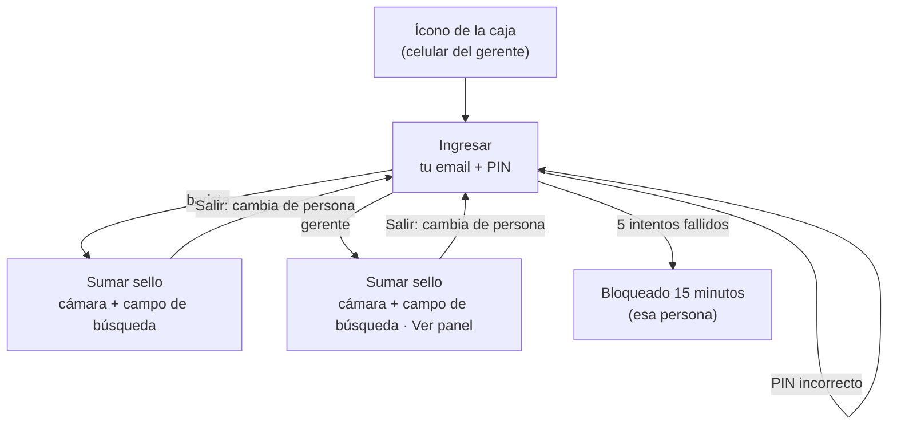
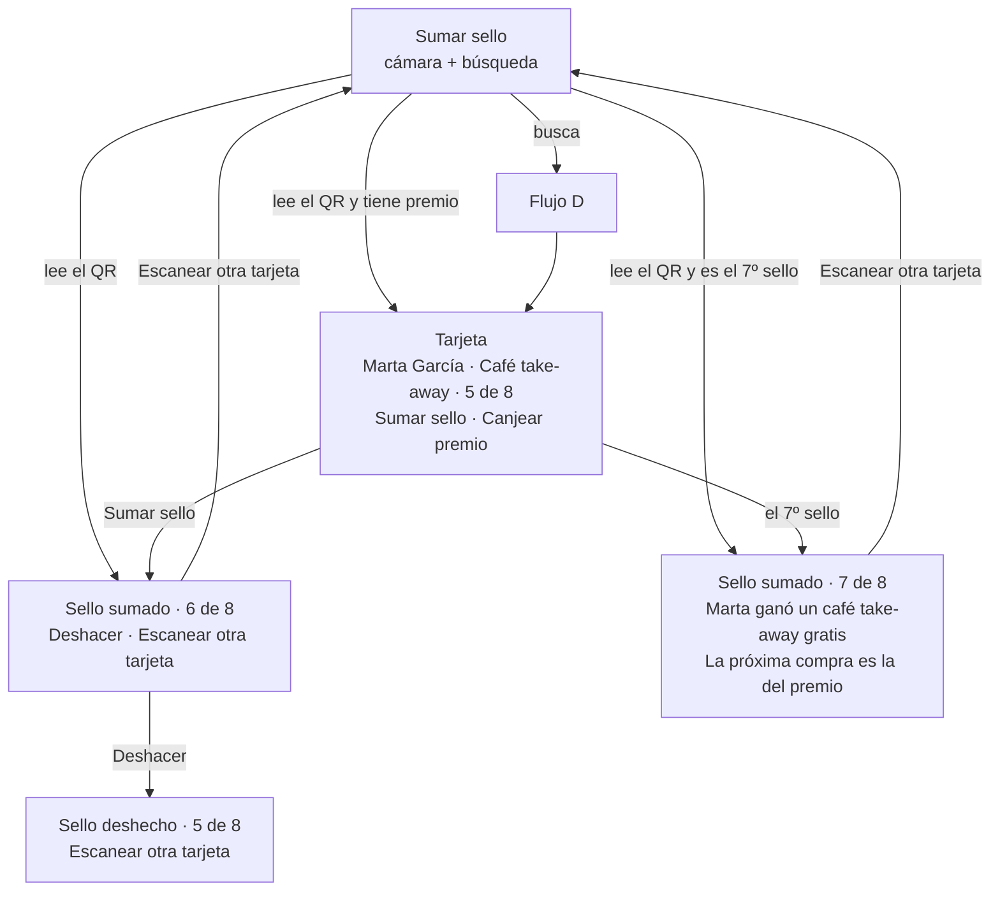
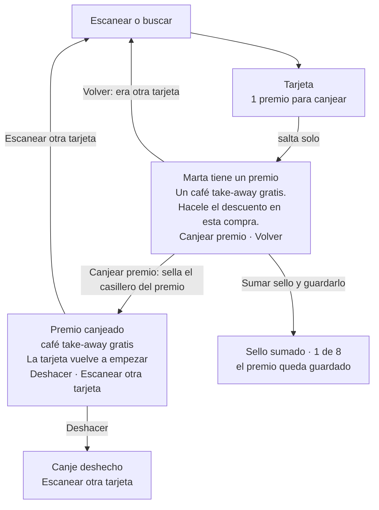
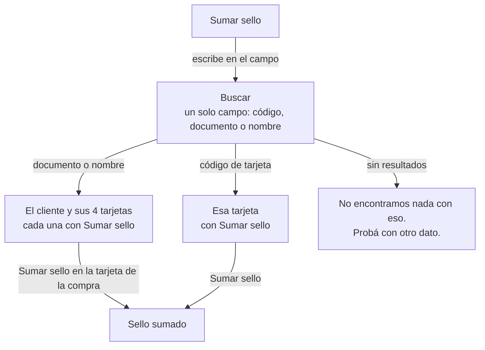
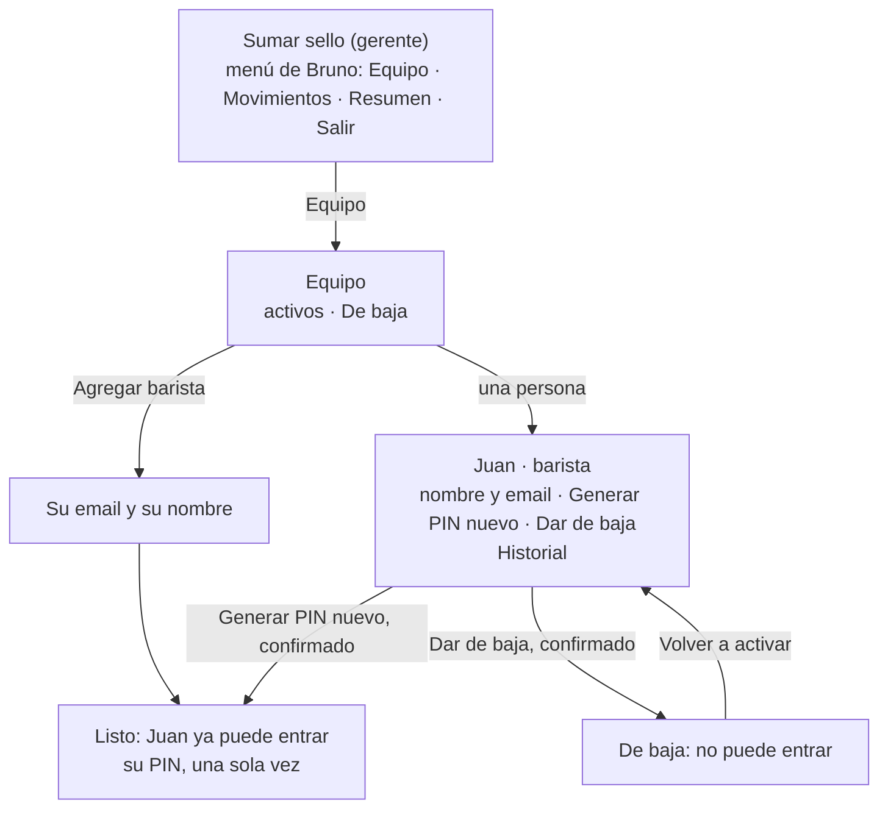
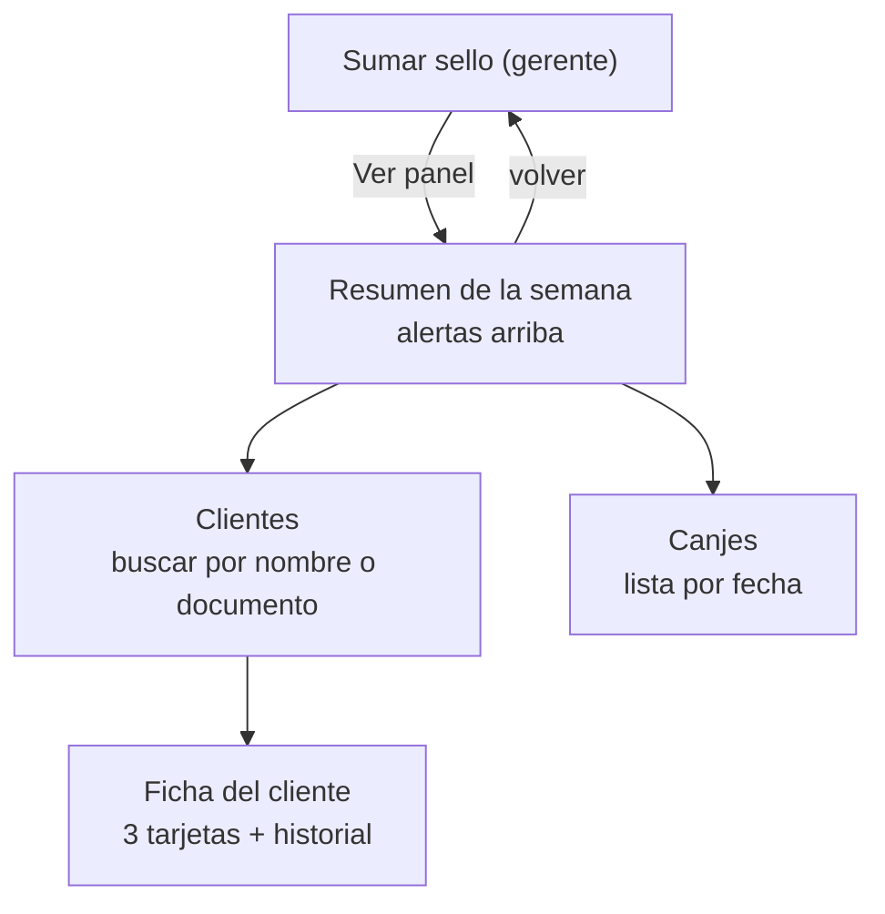
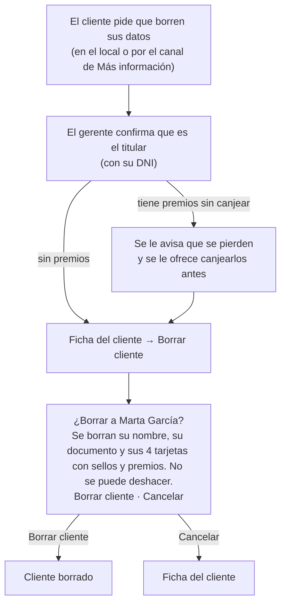

# Flujos del equipo (caja y panel)

> Documento de diseño. Define qué hacen el barista y el gerente en la app del Club. Los nombres, premios y textos de ejemplo son los de la cafetería de ejemplo (`app/src/cafes/example.ts`).
> Fecha: 01/10/2026 · Actualizado: 09/10/2026 (la caja y Equipo rediseñados; la confirmación en una hoja sobre la caja; Equipo y Salir en el menú del nombre)
> Base: [spec](propuestas-tarjeta-fidelizacion.md), [flujos del cliente](flujos-cliente.md) y las guías de [interfaz](../marca/interfaz.md) y [voz](../marca/voz.md).

## Decisiones tomadas

| Tema | Decisión |
|---|---|
| Equipo y celular | **Cada persona con su celular** (08/10/2026; antes se pensaba que las dos usaban el del gerente) |
| Dónde vive la caja | En la misma app que los clientes, con un login de equipo, en una dirección aparte (`/register`). Sin enlaces a la vista desde la app del cliente: **5 toques seguidos en el logo de la cafetería, solo en la bienvenida**, abren la caja, que igual pide email y PIN. Nunca en las pantallas de un cliente con sesión: un cliente no es un barista (08/10/2026) |
| Cuentas | Una por persona, nunca compartidas. Cada acción queda registrada con quién la hizo. **Los baristas los da de alta el gerente desde *Equipo*** (Flujo H, 08/10/2026); los gerentes, los desarrolladores con el script |
| Entrar | **Email + PIN de 6 números.** Cada persona entra con su email (único) y su PIN, con el teclado numérico. El nombre solo se muestra arriba (*Juan · barista*). 5 intentos fallidos seguidos bloquean a esa persona 15 minutos |
| Cambiar de persona | Quien va a atender toca *Salir* y entra con su email y su PIN |
| Roles | **Barista:** caja (escanear, buscar, sumar, canjear). **Gerente:** lo mismo que el barista, más *Equipo* y, después, el panel |
| Sesión | Larga en el celular del gerente: **30 días sin usar** (cada uso la renueva), hasta que alguien toque *Salir* (07/10/2026) |
| Primera salida | Caja mínima: entrar, escanear, buscar por código, documento o nombre (Flujo D, adelantado el 08/10/2026), sumar sello, canjear premio y deshacer. El panel (Flujo F) va después |
| Sumar un sello | **Escanear el QR suma el sello solo** (08/10/2026): cada tarjeta tiene su QR, así que no hay duda de a cuál va. Si se tipea el código, se abre la tarjeta y se toca *Sumar sello*. Después hay *Deshacer* y *Escanear otra tarjeta*. La confirmación sale en una **hoja encima**, con una **X** arriba a la derecha para cerrarla, sin cambiar de pantalla: desde la pantalla principal, escaneando o en los resultados (08/10/2026), y desde la tarjeta (11/10/2026). Al cerrarla, la tarjeta se pone al día |
| Canjear un premio | Si la tarjeta tiene un premio, al abrirla salta solo un aviso (08/10/2026), como el festejo del cliente (*Marta tiene un premio · 30% OFF en ¼ kg. · Si lo usa en esta compra, hacele el descuento.*), con *Canjear premio* y *Sumar sello*: el cliente puede guardarlo para otra compra (09/10/2026). Con la tarjeta en *7 de 8* (*4 de 5*), la próxima compra es el casillero del premio, como en papel (18/10/2026): el botón de la tarjeta es *Canjear premio* (sella ese casillero) y debajo está *Sumar sello y guardarlo*. *Sumar sello* sigue siendo directo: tocarlo ya es la confirmación |
| Más de un café | Se vuelve a escanear la tarjeta por cada sello. No hay *Sumar otro* ni selector de cantidad |
| El 7º sello (el 4º en grano) | La confirmación (*Sello sumado*) avisa que el cliente ganó el premio, para que el barista se lo diga: *La próxima compra es la del premio.* Canjearlo completa la tarjeta (18/10/2026) |
| Después de un canje | Solo *Deshacer* y *Escanear otra tarjeta*. No se ofrece sumar sello |
| Pantalla principal | **Sumar sello**: la cámara para escanear arriba y, debajo, la barra para buscar por nombre, documento o código de la tarjeta, siempre a la vista, sin hoja (09/10/2026). Si una búsqueda no encuentra nada, el aviso aparece debajo del campo |
| Resultado | Al buscar un cliente aparecen sus 4 tarjetas **chicas**, una por línea: una franja de su color con su nombre, *5 de 8*, una barra de progreso, el premio si tiene y **Sumar sello** a la derecha, para que entren sin scrollear. Con premio, **Sumar sello** y **Canjear premio** debajo, uno al lado del otro (09/10/2026). En *7 de 8* (*4 de 5*), solo **Canjear premio**, que abre la tarjeta: ahí también se puede guardar (18/10/2026). Si el nombre encuentra varios clientes, cada uno es una línea que se toca para abrir sus tarjetas, de a uno (08/10/2026) |
| Ficha del cliente | No muestra el documento (se guarda cifrado). Muestra nombre, fecha de alta, tarjetas e historial |
| Pedidos sobre sus datos | Si un cliente pide ver, corregir o borrar sus datos, se responde en los plazos de la ley (Flujo G). Borrar es la única acción que el gerente puede hacer desde el panel |
| Tema visual de la caja | **El mismo tema claro** que la app del cliente (06/10/2026) |

---

## Flujo A · Entrar

- **Ingresar:** el campo **Tu email** (con el teclado de email del celular), el campo del **PIN de 6 números** (con el teclado numérico; se ven puntos y el celular no ofrece guardarlo, para que nadie entre con la cuenta del otro) y el botón **Entrar** (`voz.md`: *entrar*). El email es el que cargó el gerente al darla de alta; dos personas pueden llamarse igual, pero no tener el mismo email.
  - Si no coincide, o si está bloqueada: *Revisá tu email y tu PIN. Si ya probaste varias veces, esperá 15 minutos.* Es el mismo mensaje en todos los casos, para no confirmar qué emails existen (09/10/2026).
  - Después de 5 intentos fallidos seguidos, esa persona queda bloqueada 15 minutos. El mensaje no cambia: ya dice que hay que esperar. Los desarrolladores pueden destrabarla antes.
  - No se aceptan PIN fáciles (`123456`, `000000`, `111111`…).
- **Sumar sello** (pantalla principal): arriba la cámara, siempre lista para leer el QR; debajo, *si no lo lee*, **Ingresar manualmente**, que abre una hoja con el campo y **Buscar tarjeta**. Arriba, bien visible, el nombre de quien está ingresado. Tocarlo abre un menú con **Salir** y, para el gerente, **Equipo** (Flujo H). Sin barra de pestañas abajo: *Sumar sello* ocupa toda la pantalla (09/10/2026).
- **Cambiar de persona:** las dos personas usan el celular del gerente. Antes de atender, la persona confirma que arriba dice su nombre; si no, toca *Salir* y entra con su cuenta. Lo que se haga queda a nombre de quien está ingresado.
- La sesión dura 30 días sin usar en ese celular (cada uso la renueva), hasta que alguien toque *Salir*, que no pide confirmación. Después pide el PIN de nuevo.

## Flujo B · Sumar un sello

**La tarjeta** (al buscarla, o al escanearla si tiene un premio), en este orden de lectura:
1. **Nombre del cliente**, grande: lo primero que el barista confirma.
2. **La tarjeta**, igual que la ve el cliente: su color, su nombre, *5 de 7* y la grilla de sellos.
3. **Premios**, si tiene: *1 premio para canjear*.
4. Dentro de la tarjeta, el botón **Sumar sello**. Si tiene un premio, en cambio, salta el aviso para canjearlo (Flujo C) y en la tarjeta queda un enlace chico *Canjear premio* para volver a abrirlo.

**Reglas:**
- **Escanear suma el sello solo** y va directo a la confirmación (08/10/2026). Un error se arregla con *Deshacer*. Si la tarjeta tiene un premio, no suma: abre la tarjeta con el aviso para canjearlo (Flujo C).
- Buscada por código, la tarjeta se abre y el sello se suma al tocar *Sumar sello*.
- La cámara arranca apagada: se prende al tocar el visor (*Tocá para escanear*). Después de sumar se apaga, así una sola lectura suma un solo sello; para el siguiente hay que tocar *Escanear otra tarjeta*. No hay bloqueo por tiempo.
- **Dos cafés = dos escaneos.** Por cada sello se escanea la tarjeta otra vez.
- **Deshacer** revierte ese sello y queda registrado con quién lo hizo. No borra nada. Es un enlace chico junto al dato de lo que se sumó, lejos de *Escanear otra tarjeta*: se usa poco y un botón grande se tocaba sin querer (08/10/2026). También desde una confirmación vieja (por ejemplo, volviendo atrás), si se dio cuenta tarde (07/10/2026).
- **Tocar dos veces o reintentar con mala señal suma un solo sello:** la caja guarda solo si la tarjeta sigue como la vio el barista. Si el primer toque ya había llegado, muestra su confirmación; si otra persona la cambió, vuelve a la tarjeta con *La tarjeta cambió recién. Revisala antes de seguir.*
- Si el sello completó la tarjeta y su premio ya se canjeó, **no se puede deshacer**: primero se deshace el canje (06/10/2026).
- Mientras tanto, el cliente ve el sello aparecer en vivo en su pantalla.

**Textos de la confirmación:**

| Caso | Texto |
|---|---|
| Sello normal | **Sello sumado** · Café take-away · 6 de 8 |
| El 7º sello, take-away | **Sello sumado** · Marta ganó un café take-away gratis · *La próxima compra es la del premio.* |
| El 4º sello, café en grano | **Sello sumado** · Marta ganó 30% OFF en su próxima bolsa de ¼ kg · *La próxima compra es la del premio.* |
| Deshacer | **Sello deshecho** · Café take-away · 5 de 8 |

## Flujo C · Canjear un premio

- **El premio se gana con el 7º sello (el 4º en grano) y se usa en la compra siguiente** (el 8º café, la 5ª bolsa; 10/10/2026, como en papel). La tarjeta tiene ese casillero al final (*7 de 8*, *4 de 5*): **canjear el premio es sellarlo**, y completa la tarjeta (18/10/2026). Al abrir una tarjeta con premio, el aviso salta solo y le recuerda al barista que haga el descuento si lo usa. Si el cliente lo guarda, *Sumar sello y guardarlo*, desde el aviso o desde la tarjeta: arranca la vuelta siguiente. *Volver* es para cuando escanearon otra tarjeta. Con un premio guardado, el enlace *Canjear premio* de la tarjeta abre el aviso para usarlo en cualquier compra.
- Si compra dos cosas de la misma tarjeta y usa el premio, son dos pasos: canjear el premio y sumar el sello.
- Canjear **no suma sello**.
- Después de un canje solo están *Deshacer* y *Escanear otra tarjeta*. Si el cliente además compra algo que suma, se vuelve a escanear su tarjeta.
- La confirmación dice **qué** premio es (*café take-away gratis*, *30% OFF en ½ kg*) para que el barista cobre bien.
- El cliente ve *Premio canjeado* en vivo en su pantalla.

## Flujo D · Buscar una tarjeta

- **Un solo campo** que acepta cualquiera de los tres datos: *Código de tarjeta, documento o nombre*. El sistema reconoce qué es: un código tiene letras y números, un documento son solo números y un nombre son letras.
- El resultado son **tarjetas**, no una lista: el nombre del cliente, la fecha de alta y sus 4 tarjetas en el orden fijo, cada una con su color, sus sellos y su botón **Sumar sello** (y **Canjear premio** si tiene). El barista toca el botón de la tarjeta que corresponde a la compra.
- Si busca por **nombre** y hay varias coincidencias (*Marta García* ×2), aparece cada cliente con su fecha de alta arriba de sus tarjetas, para distinguirlos. Nunca el documento.
- Si busca por **documento** o por **código**, aparece un solo cliente (el documento y el código son únicos).
- **Entra en la primera salida** (adelantado el 08/10/2026): código, documento y nombre. El nombre se busca sin tildes y por el principio de cada palabra (*mar gar* encuentra a *Marta García*); se muestran hasta 10 clientes y, si hay más, se pide el apellido. Un documento nunca vuelve a mostrarse, ni en el campo. Tiene el botón *Buscar tarjeta* a la vista (además de la tecla del teclado).
- Un código que no existe no traba la caja: queda registrado con quién lo tipeó, para la alerta del panel (fase 2).

## Flujo E · Errores

| Situación | Qué ve |
|---|---|
| El QR no es una tarjeta del Club | *Este código no es una tarjeta del Club.* · Escanear otra vez |
| Sin conexión | *Sin conexión. No se puede sumar ni canjear hasta que vuelva.* (no se guardan acciones para después: evita duplicados) |
| La cámara no tiene permiso | *Para escanear, permití usar la cámara.* + cómo hacerlo + *Buscar tarjeta* como alternativa |
| El celular corta la cámara (en iPhone quedaba gris) | Vuelve el visor apagado con *Se cortó la cámara. Tocá para escanear de nuevo.* La caja abre una sola cámara a la vez (13/10/2026) |
| Muchos códigos mal seguidos | No se bloquea la caja. Aparece una alerta en el panel del gerente (propuesta; pendiente en el spec) |
| El cliente trae la tarjeta de papel | Fase 2. Por ahora, se escanea y se suma una vez por cada sello del papel |

## Flujo H · Equipo (solo gerente)

Decidido el 08/10/2026. El gerente da de alta a los baristas y los maneja desde la caja. Es lo primero del gerente que se construye; el resto del panel (Flujo F) viene después.

| Tema | Decisión |
|---|---|
| Quién entra | Solo el gerente: ve *Equipo* en el menú de su nombre, arriba en *Sumar sello* (09/10/2026). Un barista no lo ve, y si abre la dirección vuelve a la caja |
| A quién da de alta | **Solo baristas.** Los gerentes los crean los desarrolladores con `npm run staff:create`, así nadie se da más permisos desde la app |
| El PIN | **Lo arma la app** (6 números, nunca uno fácil) y se le muestra al gerente **una sola vez**, para que se lo pase en persona. No hay mail para mandarlo. Después no se puede volver a ver: se genera otro |
| Qué se cambia | El nombre y el email; un **PIN nuevo** (el que tenía deja de servir, se le cierra la caja en su celular y se destraba); **dar de baja** y **volver a activar**. El PIN nuevo y la baja piden confirmación |
| La baja | No se borra a nadie: queda de baja, no puede entrar y sus sellos siguen a su nombre. En la lista va abajo, aparte, en *De baja* |
| Otros gerentes y uno mismo | Solo se ven. Para cambiarlos (o para un PIN nuevo del gerente), los desarrolladores con el script |
| Historial | Cada cambio queda registrado con quién lo hizo y cuándo (*Se generó un PIN nuevo · 8 de octubre, 12:00 · por Bruno*), nunca el PIN |

## Flujo I · Movimientos (solo gerente)

Decidido el 10/10/2026. El gerente ve todo lo que se hizo en la caja: cada sello, canje y deshacer de todos, baristas y gerentes. Es la primera parte del panel (Flujo F) que se construye.

| Tema | Decisión |
|---|---|
| Quién entra | Solo el gerente: *Movimientos* en el menú de su nombre, debajo de *Equipo*. Un barista no lo ve, y si abre la dirección vuelve a la caja |
| Qué muestra | Lo más nuevo arriba: qué pasó (*Sello sumado*, *Premio canjeado*, *Sello deshecho*, *Canje deshecho*), de quién y qué tarjeta (*Marta García · Café take-away*), cuándo y quién lo hizo (*8 de octubre, 12:05 · por Ana*). Lo que se deshizo después va tachado, con *Deshecho* |
| De quién | *Todos* o una persona del equipo, con un botón por persona arriba |
| Cuántos | 50 por vez; *Ver anteriores* trae los anteriores debajo |
| Cliente borrado | Sus movimientos siguen, con *Cliente borrado* en lugar del nombre (Flujo G) |
| Qué no muestra | El documento, ni los emails ni los PIN del equipo |

## Flujo J · Resumen (solo gerente)

Decidido el 11/10/2026. Los números del Club en gráficos fáciles de leer, sin nombres de clientes. Es el *Resumen de la semana* del panel (Flujo F), sin las alertas, que van después.

| Tema | Decisión |
|---|---|
| Quién entra | Solo el gerente: *Resumen* en el menú de su nombre, debajo de *Movimientos*. Un barista no lo ve, y si abre la dirección vuelve a la caja |
| Las fechas | En un solo renglón arriba (12/10/2026): **7 días**, **30 días** y **90 días** con un toque, y **Otras**, que abre *Desde* y *Hasta* encima de la pantalla. De entrada, los últimos 7 días con hoy. Nunca después de hoy; si se eligen al revés, se dan vuelta. **No se compara** con otro período. Días y horas en la hora de la cafetería |
| Los cuatro números | Arriba, en grande: **sellos** (y unos cuántos por día), **clientes que vinieron** (cada uno una vez, con cualquier tarjeta, y cuántos volvieron), **clientes nuevos** y **premios canjeados** (y cuántos hay sin canjear hoy) |
| Día por día | Por día (hasta 2 semanas), por semana desde el primer día (hasta 16 semanas) o por mes: una barra con los sellos y los clientes nuevos. Cada semana dice sus días (*14 al 20 sep*), así se ve cuál es y que la última puede ser más corta. La frase dice el día, la semana o el mes con más sellos |
| Cuántas veces vinieron | Cuántos clientes vinieron 1, 2, 3, o 4 o más **días**, con cualquier tarjeta: dos compras el mismo día son una visita. Es la medida de cuánto vuelve la gente |
| Por tarjeta | Una tabla con una columna por tarjeta: clientes que la usaron (sumaron un sello o canjearon un premio con ella, cada uno una vez), sellos, premios ganados y premios canjeados. Los sin canjear de hoy quedan solo arriba, en *Premios canjeados*. Los premios se cuentan con la regla de hoy (7º y 4º sello), como el saldo de la migración 0011. La frase dice qué tarjeta sumó más sellos |
| Días y horarios | Un mapa: una fila por hora, más oscuro donde hubo más sellos y con el número escrito en cada casilla. **Hasta 7 días**, una columna por cada día elegido, en orden y con su fecha (*ma 6* … *hoy 12*), y abajo los sellos de cada día. **Más largo**, de lunes a domingo con todas las semanas sumadas, dicho arriba del mapa, y abajo los sellos de un día así **en promedio**: en 30 días hay días de la semana que aparecen 5 veces y otros 4. La frase dice el día (o los sábados, en promedio) y la hora con más sellos |
| Cómo se ve | Cada pregunta en su caja, con la frase que dice lo principal arriba y su gráfico. Un solo color, el café de la marca, más claro a más oscuro: los colores de las tarjetas no se usan para distinguir (el ¼ kg y el ½ kg casi no se diferencian entre sí, validado con la skill de visualización). Con letra grande (200%), las tablas pasan a listas y el mapa a una barra por día y otra por hora |
| Qué cuenta | Solo los sellos y canjes que siguen en pie: lo deshecho no cuenta. El historial de un cliente borrado sigue contando; sus premios, no (ya no se pueden canjear). Un cliente borrado ya no aparece entre los nuevos |
| Qué no muestra | Nombres de clientes, documentos, emails ni PIN: solo cuentas |

## Flujo F · Panel (solo gerente, solo lectura)

El *Resumen de la semana* se construyó como *Resumen* (Flujo J, 11/10/2026), todavía sin las alertas.

Solo lectura, con una excepción: borrar a un cliente a pedido (Flujo G). No entra en la primera salida. Los datos se guardan desde el primer día, así que cuando llegue el panel ya van a estar.

**Resumen de la semana:**
1. **Alertas**, si hay, arriba de todo y con texto claro:
   - *Marta García sumó 5 sellos en 10 minutos.*
   - *8 deshacer hoy · lo normal es 1.*
   - *12 códigos mal tipeados seguidos.*
2. **Números de la semana:** sellos, canjes, clientes nuevos y clientes activos del mes, cada uno comparado con la semana anterior.
3. **Sellos por día y por hora:** un gráfico en la paleta de la marca.

**Ficha del cliente:** nombre, fecha de alta, sus 3 tarjetas con sellos y premios, y el historial (*Sello sumado · Café take-away · 30/09 9:42 · por Juan*). Incluye los *deshacer*, marcados. **Sin documento.**

**Canjes:** lista por fecha con cliente, tarjeta, premio y quién lo canjeó.

El gerente vuelve a *Sumar sello* para escanear como cualquier barista.

## Flujo G · Pedidos de un cliente sobre sus datos

La Ley 25.326 da a cada cliente derecho a saber qué datos tenemos, a corregirlos y a pedir que se borren (ver [datos personales](implementacion/datos-personales.md)). El texto de *Más información* explica cómo pedirlo.

| Pedido | Plazo de la ley | Primera salida | Después, con el panel |
|---|---|---|---|
| **Ver sus datos** (acceso) | 10 días corridos. Gratis, cada 6 meses | El gerente le muestra lo que hay o los desarrolladores se lo mandan | El gerente le muestra la *Ficha del cliente* |
| **Corregir el nombre** | 5 días hábiles | A mano, los desarrolladores, a pedido del gerente | Fase 2 |
| **Corregir el documento** | 5 días hábiles | A mano, los desarrolladores | Fase 2 (ya previsto en el spec) |
| **Borrar sus datos** | 5 días hábiles | A mano, los desarrolladores, a pedido del gerente | **Borrar cliente**, desde la *Ficha del cliente* |

**Quién lo pide:** el cliente, en el local con su DNI en la mano, o por el canal que indique *Más información*. Se confirma que es el titular comparando el documento con el que está guardado, sin mostrarlo.

**Qué se borra y qué queda:**

| Se borra | Queda, sin identidad |
|---|---|
| Nombre y documento (su hash), de verdad. Sus 3 tarjetas quedan sin dueño: no aparecen en la caja ni en ningún lado, así que pierde sus sellos y premios pendientes. Su sesión deja de servir: ya no encuentra a nadie | El historial de sellos, canjes y deshacer, con su tarjeta sin dueño, marcado como *Cliente borrado*, para que los números del panel y el control de fraude interno sigan cerrando |

**Reglas:**
- Es la única acción del equipo que **no se puede deshacer**: por eso pide confirmación explícita y avisa qué se pierde.
- Solo la hace el gerente, nunca el barista.
- Queda registrada sin el nombre: *Cliente borrado · 05/10 10:15 · por Ana*.
- Si después vuelve a anotarse con el mismo documento, es un cliente nuevo, con sus tarjetas en cero.
- Para la app del cliente no hace falta un botón propio: el público es mayor y el pedido en el mostrador es más claro. *Salir* sigue siendo solo cerrar la sesión.

## Pantallas

| # | Pantalla | Quién | Estados | Primera salida |
|---|---|---|---|---|
| 1 | Ingresar | Todos | vacío, error | Sí |
| 2 | **Sumar sello** (cámara + búsqueda) | Barista / Gerente | buscando, QR inválido; sin y con *Ver panel* | Sí, sin *Ver panel* y buscando solo por código corto |
| 3 | Permiso de cámara | Todos | — | Sí |
| 4 | Búsqueda con resultados (el cliente y sus tarjetas) | Todos | un cliente, varios clientes, sin resultados | Después (por código corto sí: muestra esa tarjeta) |
| 5 | **Tarjeta escaneada** | Todos | sin premios, con premios | Sí |
| 6 | **Confirmación de sello** | Todos | sumado, tarjeta completa, deshecho | Sí |
| 7 | Confirmación de canje | Todos | canjeado, deshecho | Sí |
| 8 | Sin conexión | Todos | — | Sí |
| 9 | Resumen de la semana | Gerente | con alertas, sin alertas | Construida sin alertas como *Resumen* (pantalla 18) |
| 10 | Clientes | Gerente | — | Después |
| 11 | Ficha del cliente | Gerente | — | Después |
| 12 | Canjes | Gerente | — | Después |
| 13 | Borrar cliente (confirmación) | Gerente | con premios, sin premios | Después (en la primera salida, a mano) |
| 14 | Equipo (Flujo H) | Gerente | activos, de baja | Sí (08/10/2026) |
| 15 | Agregar barista y el PIN, una vez | Gerente | error, PIN mostrado | Sí |
| 16 | Una persona del equipo | Gerente | se puede cambiar, solo se ve, de baja | Sí |
| 17 | Movimientos (Flujo I) | Gerente | todos, una persona, sin movimientos | Sí (10/10/2026) |
| 18 | Resumen (Flujo J) | Gerente | por día, por semana, por mes, sin sellos | Sí (11/10/2026) |

Las pantallas **2**, **5** y **6** (sumar sello, tarjeta escaneada y confirmación) son las que el barista ve decenas de veces por día: tienen que ser las más rápidas de leer.

## Pendientes

- [x] Duración de la sesión del equipo → 30 días sin usar; cada uso la renueva (07/10/2026).
- [x] Tema visual de la caja → el mismo tema claro que el cliente (06/10/2026).
- [ ] Si se limitan los intentos fallidos o solo se alerta (propuesta: solo alerta).
- [x] Cómo entra el equipo → email + PIN de 6 números, con bloqueo de 15 minutos después de 5 intentos fallidos (06/10/2026; el email reemplazó al nombre). Reemplaza a usuario y contraseña.
- [x] La pantalla *Entrar* (email + PIN) → se armó directo en código, como pide el [plan](implementacion/plan.md) para las pantallas sin wireframe (07/10/2026).
- [ ] **Quién puede borrar una cuenta:** solo el gerente a pedido (propuesta actual), también el cliente desde su app, o ambos.
- [ ] Definir el canal para pedidos sobre los datos (en el local y, por ejemplo, un mail) y quién los atiende en la primera salida.
- [x] Qué celular se usa para escanear → el del gerente, para las dos personas.
- [x] Por dónde entra el equipo → una dirección aparte (por ejemplo `/caja`), sin enlace desde la app del cliente.
- [x] Si la primera salida incluye tipear el código corto → sí. Buscar por documento o nombre va después.
- [x] Quién crea las cuentas del equipo → el gerente, los baristas, desde *Equipo* (Flujo H, 08/10/2026); los gerentes, los desarrolladores con el script.
