# CI/CD: cómo se prueba y se publica cada cambio

> Documento de trabajo. Fecha: 05/10/2026. **Decidido y armado** (archivos abajo). Alojamiento en Cloudflare ([cloudflare.md](cloudflare.md)), framework React Router 7 ([stack.md](stack.md)), cuentas y accesos ya configurados ([entorno.md](entorno.md)).

## Lo decidido

| Tema | Decisión | Fecha |
|---|---|---|
| Ambientes | **Dos: `dev` y `prod`** | 05/10/2026 |
| Ramas | **`dev` y `main`**: cada cambio entra por pull request a `dev`; de `dev` a `main` cuando el equipo decide publicar ([CONTRIBUTING.md](../../CONTRIBUTING.md)) | 05/10/2026 |
| Cuándo se publica en `dev` | **Al fusionar en la rama `dev`**. Los pull requests solo se revisan | 05/10/2026 |
| Cuándo se publica en `prod` | **Al fusionar `dev` en `main`**, solo si la CI pasó | 05/10/2026 |
| Desde dónde se publica | **GitHub Actions**, no la integración automática de Cloudflare: todo el recorrido en un solo lugar | 05/10/2026 |
| Proteger `dev` y `main` | Por acuerdo, gratis ([CONTRIBUTING.md](../../CONTRIBUTING.md)) | 05/10/2026 |
| Plan de Cloudflare | Gratis, por ahora | 05/10/2026 |

## El recorrido de un cambio

```mermaid
flowchart LR
  R["Tu rama"] --> PR["Pull request a dev"]
  PR --> CI["Revisar: formato, tipos, pruebas, compilar"]
  CI -->|verde + visto bueno del otro| D["Fusionar en dev"]
  D --> DEV["Publicar en dev<br/>migraciones + app"]
  DEV --> CEL["Probar en el celular"]
  CEL -->|cuando decidimos publicar| PR2["Pull request de dev a main"]
  PR2 -->|verde + visto bueno| M["Fusionar en main"]
  M --> PROD["Publicar en prod<br/>migraciones + app"]
```

## Los dos ambientes

| | **dev** | **prod** |
|---|---|---|
| Para qué | Probar en un celular real lo que ya entró en `dev` | La cafetería |
| App (Worker) | `club-dev` | `club` |
| Base (D1, jurisdicción UE) | `club-dev` | `club-prod` |
| Dirección | `club-dev.<cuenta>.workers.dev` | `club.<cuenta>.workers.dev` hasta tener dominio; después el de la cafetería (y se apaga la de `workers.dev`) |
| Datos | **Inventados** (*Marta García, 30.123.456*). Se pueden borrar cuando se quiera | Reales. Nunca se copian a dev |
| Rama | `dev` | `main` |
| Se publica | Al fusionar en `dev` | Al fusionar `dev` en `main` |
| `DNI_HMAC_KEY` | Una clave de prueba | La de verdad (Bitwarden + papel) |
| `PIN_HMAC_KEY` | Una clave de prueba | La de verdad (Bitwarden) |
| `CUSTOMER_SESSION_KEY`, `STAFF_SESSION_KEY` | Claves de prueba | Las de verdad (Bitwarden) |
| `TURNSTILE_SECRET_KEY` | La del widget `club` | La del widget `club` |
| *Time Travel* (volver la base atrás) | 7 días | 7 días (30 con el plan pago) |

Además, cada uno tiene su **ambiente local** en la compu: `npm run dev` levanta la app con una copia de D1 en el disco y las claves de prueba de `.dev.vars`. No toca ni dev ni prod.

**Las bases y el widget de Turnstile ya están creados** ([entorno.md](entorno.md)). Los Workers se crean solos con la primera publicación.

## CI: en cada pull request y en cada fusión

Con **GitHub Actions**. Repo privado en cuenta gratis: **2.000 minutos por mes**. Una corrida tarda 2 o 3 minutos.

| Paso | Qué revisa | Comando |
|---|---|---|
| Instalar | Dependencias exactas del `package-lock.json`, con caché | `npm ci` |
| Formato y lint | Las reglas acordadas | `biome check` |
| Tipos | Errores de TypeScript | `react-router typegen && tsc` |
| Pruebas unitarias | Reglas del negocio: sumar, completar, canjear, deshacer, hash del DNI | `vitest run` |
| Compilar | Que la app se pueda publicar | `react-router build` |
| Recorridos y accesibilidad | En otro job, en paralelo: los recorridos del cliente (anotarse, volver a entrar) y una pasada de axe y de las reglas de pantalla por cada pantalla. Los de la caja se suman en la etapa 4. Si fallan, el informe queda para descargar | `npm run test:e2e` (Playwright, celular de 360 × 740) |

Si un paso falla, **no se publica nada**, ni en dev ni en prod.

## CD: publicar

### En dev, al fusionar en la rama `dev`

1. La CI pasa otra vez, sobre `dev`.
2. Se aplican las **migraciones** a `club-dev` (`wrangler d1 migrations apply --remote`).
3. Se publica la app en `club-dev`: `https://club-dev.<cuenta>.workers.dev`.

**Los pull requests no se publican:** solo se revisan. Lo que se prueba en el celular es lo que ya está en `dev`. Si un día hace falta probar un pull request antes de fusionarlo, Cloudflare permite una dirección por pull request (*preview URLs*) sobre la misma base de dev.

**Dependabot** abre sus pull requests contra `dev`, como todos.

### En prod, al fusionar `dev` en `main`

1. La CI pasa otra vez, sobre `main`.
2. Se aplican las **migraciones** a `club-prod`.
3. Se publica la app en `club`.

Nunca se publica en prod desde una rama, ni desde la compu de nadie.

### Las migraciones (cambios en la base)

- Las genera **Drizzle** como archivos SQL en `migrations/` con `npm run db:generate` (`drizzle-kit generate`), y van en el pull request como cualquier cambio. Claude lo tiene permitido en [`.claude/settings.json`](../../.claude/settings.json) porque solo escribe archivos en la compu.
- Las aplica `wrangler` **antes** de publicar la app: la app nueva siempre encuentra la base lista.
- **Regla: cada migración tiene que funcionar con la versión anterior de la app** (agregar antes de quitar). Así, si hay que volver atrás la app, la base no se rompe.
- Si una migración que llegó a `dev` se descarta antes de pasar a `main`, la base de dev queda con un cambio de más. Como los datos son inventados, se borra la base de dev y se vuelve a crear con las migraciones de `dev`.

### Si algo sale mal en prod

| Qué pasó | Qué se hace |
|---|---|
| La app nueva tiene un error | Se vuelve a la versión anterior desde el panel de Cloudflare o con `wrangler rollback`. Tarda segundos |
| Se rompieron datos | *Time Travel*: se vuelve la base a un minuto anterior (hasta 7 días atrás en el plan gratis) |
| Después del arreglo de urgencia | Se corrige en una rama, pull request a `dev` y enseguida de `dev` a `main` |

## Secretos y configuración

| Qué | Dónde vive | Para qué |
|---|---|---|
| `CLOUDFLARE_API_TOKEN` | GitHub → *Secrets* (cargado) | Publicar y migrar en los dos ambientes. Vence el 05/10/2027 |
| `CLOUDFLARE_ACCOUNT_ID` | GitHub → *Variables* (cargado) | Que `wrangler` sepa qué cuenta usar |
| `DNI_HMAC_KEY` | Cloudflare, en cada Worker | Hash del DNI. **Distinta en dev y en prod** |
| `PIN_HMAC_KEY` | Cloudflare, en cada Worker | Hash del PIN del equipo. **Distinta en dev y en prod** |
| `CUSTOMER_SESSION_KEY`, `STAFF_SESSION_KEY` | Cloudflare, en cada Worker | Firmar las sesiones. **Distintas en dev y en prod.** Cambiar una saca a todos los clientes o a todo el equipo |
| `TURNSTILE_SECRET_KEY` | Cloudflare, en cada Worker | Validar Turnstile |
| ID de cada base | `wrangler.jsonc`, en el repo | No es secreto |

En un repo privado gratis, GitHub no tiene *environments* con secretos propios: el mismo token sirve para los dos ambientes, y qué ambiente se toca lo decide cada paso del CI/CD.

La **clave del DNI de prod** se genera una sola vez, antes del lanzamiento, y no se cambia nunca con clientes anotados ([entorno.md](entorno.md), paso 5).

## Los archivos

| Archivo | Qué tiene |
|---|---|
| [`app/wrangler.jsonc`](../../app/wrangler.jsonc) | **prod** arriba (`club` + `club-prod`) y **dev** como ambiente aparte (`env.dev`: `club-dev` + `club-dev`). Se elige con `CLOUDFLARE_ENV=dev` al compilar |
| [`.github/workflows/ci-cd.yml`](../../.github/workflows/ci-cd.yml) | **Revisar** (siempre); **Publicar en dev** (solo al fusionar en `dev`, después de revisar); **Publicar en prod** (solo en `main`, después de revisar). Cada publicación en su propia fila, para que nunca corran dos juntas |
| [`.github/dependabot.yml`](../../.github/dependabot.yml) | Un pull request por semana, **contra `dev`**, con las actualizaciones de npm y de GitHub Actions agrupadas |
| `app/migrations/` | Las migraciones en SQL. Hoy vacía: las genera Drizzle cuando aparezca la primera tabla |
| [`app/.dev.vars.example`](../../app/.dev.vars.example) | Las claves de prueba para la compu |

**Comandos que usa el CI/CD** (desde `app/`):

| Paso | dev | prod |
|---|---|---|
| Migrar la base | `wrangler d1 migrations apply DB --remote --env dev -c wrangler.jsonc` | `wrangler d1 migrations apply DB --remote -c wrangler.jsonc` |
| Compilar | `CLOUDFLARE_ENV=dev npm run build` | `npm run build` |
| Publicar | `wrangler deploy` | `wrangler deploy` |

El `-c wrangler.jsonc` hace que las migraciones lean la configuración del repo y no la que deja la compilación.

## Mantenimiento automático

- **Dependabot:** un pull request por semana con las actualizaciones agrupadas, para no llenar el repo de avisos. Las alertas de seguridad ya están activadas.
- **Monitoreo de caída:** un chequeo externo gratuito (por ejemplo, UptimeRobot) que avise por mail si prod no responde. Cuando se lance.
- **Errores:** los registros de Cloudflare (*observability*) alcanzan para la primera salida. **Nunca se registran el DNI ni el nombre** ([cloudflare.md](cloudflare.md), *Datos personales*).

## Abiertos

- [ ] Definir quién recibe los avisos de caída.
- [ ] Ver la primera corrida en GitHub: la primera fusión en `dev` publica en dev; la primera de `dev` a `main`, en prod.

## Fuentes

- [Cambios de precios de GitHub Actions 2026](https://cicdcost.com/github-actions-pricing-changes-2026) · [heise: GitHub Actions en repos privados](https://heise.de/-11118027)
- [Rulesets: disponibilidad por plan](https://docs.github.com/en/repositories/configuring-branches-and-merges-in-your-repository/managing-rulesets/about-rulesets)
- [D1 Time Travel](https://developers.cloudflare.com/d1/reference/time-travel/)
- [Ambientes de Wrangler](https://developers.cloudflare.com/workers/wrangler/environments/) · [Migraciones de D1](https://developers.cloudflare.com/d1/reference/migrations/)
