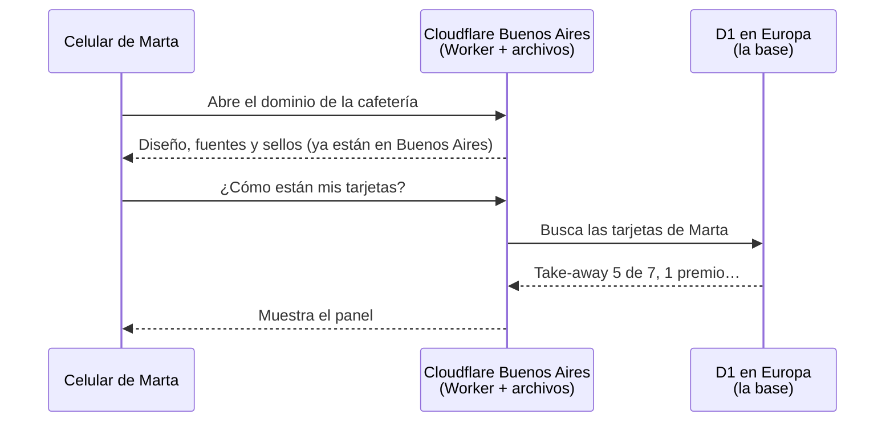

# Cómo funciona Cloudflare

> Documento de trabajo. Fecha: 05/10/2026. **Decidido: el alojamiento es Cloudflare** (05/10/2026). Explicación de cómo funciona, de los planes y del uso estimado. Límites y precios consultados en esa fecha.

## Qué es Cloudflare

Una empresa de EE. UU. con una de las redes más grandes de internet: centros de datos en más de 300 ciudades, **uno de ellos en Buenos Aires desde 2015**. Empezó protegiendo y acelerando sitios web (una parte grande de internet pasa por su red) y hoy también aloja aplicaciones completas.

La idea central: **en vez de tener la app en una computadora en un lugar, la app corre en todos sus centros de datos a la vez**. Cada cliente es atendido por el más cercano; en Argentina, el de Buenos Aires.

## Las piezas que usamos

| Pieza | Para qué | Una imagen |
|---|---|---|
| **DNS** | Dice a dónde va el dominio de la cafetería | La guía telefónica |
| **Workers** | Corre el código de la app: valida el DNI, suma el sello, arma las pantallas | Un cocinero en cada sucursal, que prepara el pedido ahí mismo |
| **Archivos estáticos** (*Static Assets*) | Sirve lo que no cambia: el diseño de la app, las fuentes, los sellos dibujados | La vitrina, ya armada en cada sucursal |
| **D1** | La base de datos: clientes, tarjetas, sellos, historial. **Vive en un solo lugar: Europa** (jurisdicción UE) | El libro de registro central, que se consulta a distancia |
| **Turnstile** | Frena a los robots en el alta y el ingreso, sin pedir que la persona elija semáforos | Un control invisible en la puerta |
| R2 (opcional) | Guardar la exportación mensual de la base | Un depósito |
| Durable Objects (más adelante) | Avisar al instante a la pantalla del cliente cuando la caja suma | Un mensajero directo |

Todo en **una sola cuenta**, con un solo panel y una sola factura.

## Qué pasa cuando Marta abre su tarjeta

1. El celular pregunta por el dominio de la cafetería; el DNS de Cloudflare lo manda al centro de datos de Buenos Aires.
2. Allí ya están el diseño, las fuentes y los dibujos: llegan al instante.
3. Para los datos de Marta, el Worker consulta la base en Europa. Ese viaje de ida y vuelta es lo que suma **unos 0,2 segundos**.
4. Si la base está lejos y una pantalla necesita varias consultas, Cloudflare puede correr el Worker cerca de la base (*Smart Placement*) para que el viaje largo sea uno solo.

**El código sin conexión no depende de Cloudflare:** la app guardada en el celular (PWA) conserva el QR y el código corto, así que se muestran aunque no haya internet.

## Qué pasa cuando el barista toca *Sumar sello*

1. El celular del gerente manda *Sumar sello* al Worker de Buenos Aires.
2. El Worker verifica que quien lo pide es del equipo, anota el sello en la base de Europa y guarda quién lo hizo.
3. La caja muestra *Sello sumado · 6 de 7*.
4. El Worker le avisa al *Durable Object* de esa tarjeta, que tiene abierta la conexión con la pantalla de Marta: el sello nuevo aparece al instante y se "imprime".

Todo el recorrido tarda menos de medio segundo.

## Qué significa "sin servidor"

No hay una computadora nuestra encendida esperando. Cuando llega un pedido, Cloudflare arranca el código en milisegundos, responde y lo apaga. Por eso:

- **No hay sistema operativo que actualizar** ni parches de seguridad que aplicar.
- **No hay arranque lento** después de horas sin uso, ni la app "se duerme" si el local cierra por vacaciones.
- Se paga (si se paga) por uso, no por tener una máquina prendida.

## Cómo se trabaja día a día

| Momento | Qué se hace |
|---|---|
| Desarrollar | En la compu, con `wrangler` (la herramienta de Cloudflare), que simula los Workers y una copia local de la base |
| Proponer un cambio | Pull request: Cloudflare publica una **vista previa con su propia dirección** para probarla en un celular real |
| Publicar | Al fusionar en `main`, GitHub Actions aplica los cambios de la base y publica. Tarda segundos |
| Algo salió mal | Se vuelve a la versión anterior con un clic. Si se rompieron datos, *Time Travel* deja volver la base a un minuto anterior |
| Claves secretas | La clave del hash del DNI se guarda en los secretos de Cloudflare: no está en el código ni la ven los registros |
| Ver qué pasa | Registros en vivo y métricas en el panel |

## Los dos planes y nuestro uso estimado

### Cómo estimamos el uso

Supuesto de un **día de mucho movimiento**: 600 ventas (50 por hora durante 12 horas). Cada venta genera unos **20 pedidos**: abrir la app (~5), mostrar el código con las consultas cada 2–3 s (~10) y la caja (~5). Un mes se calcula como 30 días así, que es más de lo real.

| Medida | Por día | Por mes |
|---|---|---|
| Pedidos | ~12.000 | ~360.000 |
| Tiempo de cálculo (unos 5 ms por pedido) | ~60.000 ms | ~1,8 millones de ms |
| Filas leídas de la base (unas 10 por pedido) | ~120.000 | ~3,6 millones |
| Filas escritas (sello, historial, altas: unas 4 por venta) | ~2.500 | ~75.000 |
| Tamaño de la base | — | Menos de 100 MB al cabo de un año, con 10.000 clientes |
| Apps (Workers) | — | 1–2 (la app; más adelante, la tienda) |
| Bases (D1) | — | 2 (producción y prueba) |

### Plan gratuito vs. plan de USD 5

| | **Gratis** | **Pago** | **Nuestro uso** |
|---|---|---|---|
| **Precio** | USD 0 | **USD 5 por mes por cuenta** (todas las apps y bases) | — |
| Con impuestos argentinos | — | ~USD 6,05 con dólares propios · ~USD 7,55 en pesos | — |
| **Pedidos** | 100.000 por día | 10 millones por mes (después, USD 0,30 por millón) | ~12.000/día · ~360.000/mes → **12 % del gratis · 4 % del pago** |
| **Tiempo de cálculo** | 10 ms por pedido | 30 millones de ms por mes; hasta 30 s por pedido | ~5 ms por pedido · ~1,8 M ms/mes → **entra en los dos** |
| **Apps (Workers)** | 100 | 500 | 1–2 |
| **Bases (D1)** | 10 | 50.000 | 2 |
| **Tamaño por base** | 500 MB | 10 GB | < 100 MB el primer año → **20 % del gratis** |
| **Espacio total de bases** | 5 GB | 5 GB incluidos (después, USD 0,75 por GB) · hasta 250 GB | < 100 MB |
| **Lecturas de la base** | 5 millones de filas por día | 25.000 millones por mes | ~120.000/día → **2 % del gratis** |
| **Escrituras de la base** | 100.000 filas por día | 50 millones por mes (después, USD 1 por millón) | ~2.500/día → **2,5 % del gratis** |
| **Respaldos (*Time Travel*)** | 7 días | **30 días** | — |
| **Si se pasa un límite** | **Falla hasta la medianoche UTC (21 h en Argentina)** | Se cobra el excedente; no falla | — |
| Tráfico de salida | Sin cargo | Sin cargo | — |
| DNS, HTTPS y Turnstile | Gratis | Gratis | Los usamos en los dos |
| Uso comercial | Permitido | Permitido | — |
| Durable Objects (tiempo real, más adelante) | Incluido con límites chicos | Incluido | No en la primera salida |

### Qué cambia en la práctica

| | **Gratis** | **Pago** |
|---|---|---|
| ¿Alcanza para el Club? | **Sí**, con mucho margen | Sí, sobrado |
| Riesgo | Que un pico inesperado (o un error en el código que haga pedidos en bucle) llegue al límite diario: **la caja deja de funcionar hasta las 21 h** | Un pico se paga con centavos de excedente; nada se corta |
| Respaldos | Una semana para notar un problema y volver atrás | Un mes |
| Con la tienda online | Probablemente alcance, más justo | Sobrado |

**Decidido (05/10/2026): plan gratis, por ahora.** Se revisa antes del lanzamiento. El cambio de plan es un clic y no requiere tocar nada de la app.

La percepción del 30 % es a cuenta (se descuenta en Ganancias o Bienes Personales, o se pide la devolución). El Impuesto PAIS ya no existe desde diciembre de 2024. Las reglas impositivas cambian seguido: confirmarlas al contratar.

**Dónde verlo:** en la cuenta, *Workers & Pages* → *Planes*. No confundir con los planes de sitio web de cloudflare.com/plans (Free, Pro, Business), que son por dominio y no hacen falta: alcanza con el Free.

## Dominio propio

- El plan gratis permite usar dominio propio sin costo extra (*Custom Domains*), con HTTPS automático. El dominio se compra aparte ([dominio.md](dominio.md)).
- Sin dominio, la app queda en una dirección `….workers.dev`, útil para desarrollar y probar.
- **Pendiente técnico:** desactivar la dirección `workers.dev` en producción, para que la app solo se use desde el dominio propio.

## Límites técnicos a tener en cuenta

- **No es Node completo.** El código corre en un entorno propio de Cloudflare: la mayoría de las librerías modernas funcionan, algunas no. Antes de sumar una librería, comprobar que funcione en Workers.
- **La base está en un solo lugar.** Cada escritura viaja a Europa. Para el Club no importa; para algo con miles de escrituras por segundo, sí.
- **Una base pesa como máximo 10 GB.** Para el Club y una tienda de este tamaño es muchísimo; si algún día no alcanzara, se divide en varias bases.
- **Hasta 50 consultas a la base por pedido** en el modo estándar: de sobra para nuestras pantallas.

## Datos personales

- La base se crea con **jurisdicción UE**: Cloudflare garantiza que se guarda y procesa en la Unión Europea, que la AAIP considera adecuada (ver [datos-personales.md](datos-personales.md)). **Se elige al crearla y no se puede cambiar después.**
- El código corre en toda la red (Buenos Aires incluido) y algunos registros técnicos pueden quedar fuera de la UE: **no registrar el DNI ni el nombre en los registros**.
- Cloudflare es una empresa de EE. UU.: la ley argentina mira dónde se guardan los datos, pero un proveedor estadounidense puede recibir pedidos de autoridades de su país. Para nuestros datos (nombre y DNI con hash, nada sensible), el riesgo es bajo.

## Confiabilidad: lo bueno y lo malo

- **Lo bueno:** es una de las redes más robustas de internet. No depende de una máquina: si un centro de datos falla, otro atiende.
- **Lo malo:** cuando Cloudflare falla, falla para todos sus clientes a la vez. Las caídas más importantes de los últimos tiempos:
  - **18/11/2025:** la peor desde 2019, de **casi 6 horas**, por un archivo de configuración interno. Afectó a una parte enorme de internet.
  - **Junio de 2025:** unas 2 horas y media, que afectó a Workers y a Turnstile.
  - **5/12/2025 y 20/2/2026:** incidentes más cortos, también por errores internos.
- **Qué significaría para el Club:** mientras dure, la caja no puede sumar ni canjear (como cuando se corta internet en el local) y nadie puede anotarse. **El código del cliente se sigue mostrando** porque queda guardado en el celular. Pasada la caída, todo sigue igual; no se pierden datos.

Ningún proveedor tiene cero caídas.

## Si un día queremos irnos

Quedar atados es el punto débil de Cloudflare. Cómo bajamos el riesgo:

1. **React Router corre igual en Cloudflare y en un servidor Node común.**
2. **Drizzle habla SQLite y Postgres**: se puede cambiar de D1 a Postgres sin reescribir todo.
3. **Exportar la base todos los meses** (`wrangler d1 export` genera un archivo SQL estándar).
4. Usar lo propio de Cloudflare (Durable Objects, KV) solo donde haga falta.

Con eso, mudarse a un servidor propio o a otra plataforma es cuestión de días, no de rehacer la app.

## Cuentas

- **Una cuenta de Cloudflare propia del proyecto** (decidido el 05/10/2026), no la personal de uno de los dos. Paso a paso y qué vería el dueño si se le diera acceso: [entorno.md](entorno.md).
- Los dos desarrolladores como **miembros**, con verificación en dos pasos.
- La tarjeta, si se usa el plan pago, la define el acuerdo con la cafetería (hoy el spec dice que el alojamiento lo pagan los desarrolladores).

## Preguntas frecuentes

| Pregunta | Respuesta |
|---|---|
| ¿Hace falta saber de servidores? | No. Hace falta saber programar la app y usar `wrangler` |
| ¿Qué pasa si se corta internet en el local? | Lo mismo con cualquier alojamiento: la caja no puede sumar hasta que vuelva (ya está en los flujos). El cliente ve su código igual |
| ¿Podemos ver los datos? | Sí: desde el panel de D1 se pueden hacer consultas, y se exportan cuando se quiera |
| ¿Y si crece mucho? | Escala solo. Lo que crece es la factura, y muy despacio: el plan de USD 5 cubre muchísimo más que el local |
| ¿El dominio tiene que estar en Cloudflare? | Los DNS sí, conviene. El dominio puede ser `.com` comprado ahí o `.com.ar` de nic.ar delegado a Cloudflare |

## Fuentes

- [Límites de D1](https://developers.cloudflare.com/d1/platform/limits/index.md) · [Precios de Workers](https://developers.cloudflare.com/workers/about/pricing) · [Precios de D1](https://developers.cloudflare.com/d1/platform/pricing/)
- Impuestos: [Dólar tarjeta 2026 (Fortuna)](https://fortunaweb.com.ar/blog/dolar-tarjeta-2026-como-se-calcula-el-costo-real-de-pagar-en-el-exterior) · [Percepción de Ganancias en servicios digitales (Global66)](https://www.global66.com/blog/como-afectan-los-impuestos-a-tus-gastos-digitales/) · [IVA RG 4240 en 2026 (nacho.com.ar)](https://nacho.com.ar/iva-netflix-cobraran-el-impuesto-a-los-usuarios-de-servicios-digitales/) · [Sin Impuesto PAIS (Perfil)](https://www.perfil.com/noticias/economia/sin-impuesto-pais-como-cambia-el-costo-real-de-pagar-con-tarjeta-en-el-exterior-en-2026.phtml) · [Jurisdicción de datos de D1](https://developers.cloudflare.com/d1/configuration/data-location/) · [D1 Time Travel](https://developers.cloudflare.com/d1/reference/time-travel/) · [Límites del plan gratis de Cloudflare (2026)](https://eastondev.com/blog/en/posts/dev/20260526-cloudflare-free-limits/)
- [Centro de datos de Buenos Aires (blog de Cloudflare)](https://blog.cloudflare.com/buenos-aires/)
- Caídas: [18/11/2025 (ilert)](https://www.ilert.com/postmortems/cloudflare-global-outage-nov-2025) · [Junio de 2025 (ilert)](https://www.ilert.com/postmortems/cloudflare-outage-june-2025) · [Impacto del 18/11/2025 (Pinggy)](https://pinggy.io/amp/blog/cloudflare_outage_november_18_2025/) · [Otros incidentes (CyberInsider)](https://cyberinsider.com/?p=289258)
