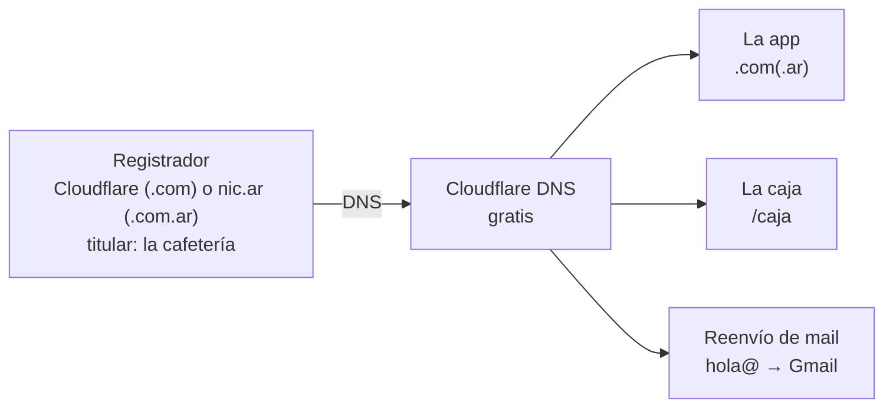

# Dominio

> Guía para elegir y configurar el dominio de cada cafetería. Las opciones habituales: `<cafeteria>.com` en Cloudflare o `<cafeteria>.com.ar` en NIC Argentina (ver *Las dos opciones*). Precios consultados el 05/10/2026: **verificarlos antes de comprar**.

## Para qué lo usamos

Esto define qué importa del nombre:

| Uso | Qué tan seguido se tipea | Qué pide del dominio |
|---|---|---|
| El cliente llega al Club | Casi nunca: **escanea el QR del mostrador** | Que sea confiable cuando lo ve en la barra del navegador |
| El ícono de la caja (`/caja`) | Una vez, al guardarlo en el celular del gerente | Nada en especial |
| Compartir el Club (Instagram, WhatsApp) | A veces | Que se lea y se dicte fácil |
| **Tienda online** (etapa 2) | Seguido: la gente lo busca y lo tipea | Corto, obvio y con cara de comercio argentino |
| Mail del local (`hola@…`) | Seguido | Corto y sin confusiones al dictarlo |

Para el Club, el nombre casi no se tipea. Pesa más la tienda: conviene elegir pensando en ella desde ahora.

Se compararon otras extensiones (`.ar`, `.cafe`, `.app`, `.shop`) y registradores (revendedores argentinos, Porkbun, Namecheap, GoDaddy). Quedaron dos opciones, abajo. Si se usa un revendedor, revisar que el titular quede a nombre de la cafetería.

## A nombre de quién

El spec ya recomienda que el dominio sea **de la cafetería** (riesgo *Dominio y continuidad*).

| | A nombre de la cafetería (propuesta) | A nombre de un desarrollador | A nombre de un revendedor |
|---|---|---|---|
| Si un desarrollador deja el proyecto | El dominio sigue siendo del local | Hay que transferirlo | Depende del revendedor |
| Trámite en nic.ar | El titular entra con **su clave fiscal** (ARCA). Si es una sociedad, alguien autorizado | Lo hace el desarrollador | Lo hace el revendedor |
| Riesgo | Ninguno | Medio | **Alto:** si el revendedor cierra o no renueva, se pierde |

Para los dominios internacionales (`.com`) no hace falta clave fiscal: se crea la cuenta del registrador **con el mail del local** y se comparte el acceso con los desarrolladores.

## Las dos opciones

Se decide con cada cafetería; mientras tanto, todo lo demás puede avanzar (ver *Qué depende de esta decisión*).

### Opción 1 · `<cafeteria>.com` en Cloudflare Registrar

| | |
|---|---|
| **Estado** | Buscarlo en el registrador. Confirmar al comprar que el precio sea el normal y no *premium* |
| **Qué incluye** | El dominio, los DNS de Cloudflare, HTTPS automático, ocultamiento de los datos del titular y reenvío de mail gratis |
| **Requisitos** | Una cuenta de Cloudflare creada con el mail de la cafetería, una tarjeta y verificación en dos pasos |
| **Costo** | **~USD 11,17 por año** (desde el 1/11/2026). Con impuestos: **~USD 12,66** pagando con dólares propios (IVA 21 %) o **~USD 15,69** pagando en pesos (IVA + percepción del 30 %). La renovación se cobra al precio vigente de cada año, sin recargo de Cloudflare |
| **Tiempo hasta tenerlo** | Minutos |
| **Renovación** | Automática con la tarjeta, o hasta 10 años pagados de una vez. Riesgo: que venza la tarjeta sin que nadie lo note |
| **DNS** | Obligatoriamente en Cloudflare mientras el dominio esté registrado ahí |
| **Privacidad del titular** | Oculta |
| **Percepción** | Universal y profesional, sin señal de país |
| **Buscadores** | Hay que indicar el país con el contenido. Diferencia chica para la tienda |
| **Riesgos** | Quien tipee `<cafeteria>.com.ar` por costumbre puede llegar a otro lado. Si se espera para comprarlo, otro puede tomarlo |
| **Pasos** | 1. Crear la cuenta con el mail del local · 2. Comprar · 3. Activar la renovación automática y los avisos · 4. Sumar a los desarrolladores como miembros |

### Opción 2 · `<cafeteria>.com.ar` en NIC Argentina

| | |
|---|---|
| **Estado** | Buscarlo en nic.ar. Si ya tiene titular, ver *Cómo se consigue uno que ya tiene dueño* |
| **Qué incluye** | Solo el dominio. Los DNS se delegan a otro servicio (Cloudflare, gratis) |
| **Requisitos** | Que el titular del local tenga CUIT, **clave fiscal nivel 3 de ARCA** y adhiera los servicios de NIC y de Trámites a Distancia. Y, antes, conseguir el dominio (abajo) |
| **Costo** | ARS 8.500 por año, en pesos. Si se compra a un titular actual, lo que se acuerde |
| **Tiempo hasta tenerlo** | Días, si está libre. Si tiene dueño, incierto: desde días, si lo transfiere, hasta nunca, si lo sigue renovando |
| **Renovación** | Año a año, desde 30 días antes del vencimiento, entrando con la clave fiscal |
| **DNS** | Se delegan a Cloudflare desde el panel de NIC |
| **Privacidad del titular** | **Pública**: nombre, CUIT y fechas, para cualquiera que lo busque |
| **Percepción** | "Comercio argentino": confianza local, sobre todo en gente mayor |
| **Buscadores** | Google lo asocia automáticamente a Argentina: ayuda a la tienda en búsquedas locales |
| **Riesgos** | No depende de nosotros conseguirlo. Burocracia de clave fiscal para cada trámite |
| **Pasos** | 1. Registrarlo a nombre de la cafetería (o, si tiene dueño, ver abajo) · 2. Delegar los DNS a Cloudflare |

#### Cómo se compra `<cafeteria>.com` en Cloudflare

1. **Crear la cuenta de Cloudflare** con el mail del proyecto o de la cafetería (no personal) y activar la verificación en dos pasos.
2. **Cargar un medio de pago:** *Manage Account* → *Billing*. Cloudflare Registrar exige una tarjeta cargada.
3. Ir a **Domain Registration → Register Domains** y buscar `<cafeteria>.com`.
4. Si está libre, muestra el precio: **USD 10,46** hasta el 31/10/2026 (~USD 11,17 desde el 1/11). **Si figura mucho más caro, es un dominio *premium* o una reventa: no comprar sin hablarlo.**
5. Elegir **cuántos años** (de 1 a 10) y dejar activada la **renovación automática**.
6. Completar los **datos del titular**: la cafetería (razón social o la persona responsable), con un mail que lean. Los datos no se publican: Cloudflare los oculta.
7. Pagar. El dominio queda activo en minutos, con los DNS ya configurados en la misma cuenta.
8. **Confirmar el mail de verificación** que llega al titular (exigido por ICANN, el organismo internacional de dominios). Si no se confirma en 15 días, el dominio se suspende.

**Costo (octubre de 2026):**

| | 1 año | Con IVA 21 % (dólares propios) | Con IVA y percepción del 30 % (en pesos) |
|---|---|---|---|
| Comprando antes del 1/11/2026 | USD 10,46 | ~USD 12,66 | ~USD 15,69 |
| Desde el 1/11/2026 (aumento del registro de `.com`) | ~USD 11,17 | ~USD 13,52 | ~USD 16,76 |

Las renovaciones se cobran al precio vigente de ese momento, sin recargo de Cloudflare. Pagar varios años juntos no da descuento, pero evita olvidos y congela el precio de esos años.

**A tener en cuenta:** durante los primeros 60 días no se puede pasar el dominio a otro registrador (regla de ICANN), y mientras esté en Cloudflare Registrar sus DNS tienen que estar en Cloudflare.

#### Cómo se consigue uno que ya tiene dueño

| Camino | Cómo | Cuándo |
|---|---|---|
| **Que el titular lo transfiera** | Inicia la transferencia en nic.ar (Trámites a Distancia) a nombre de la cafetería, y la cafetería la acepta con su clave fiscal y paga el arancel | En cualquier momento, salvo durante el período de gracia o una disputa |
| **Esperar que venza** | Si no lo renueva, tiene un **período de gracia de 30 a 45 días**. Si tampoco lo renueva ahí, queda libre para el primero que lo pida | Entre 30 y 45 días después del vencimiento |
| **Disputa en nic.ar** | Solo si la cafetería tiene mejor derecho, por ejemplo una **marca registrada en el INPI** anterior al dominio | Lenta y sin garantía |

### Lo que es igual en las dos

- El dominio queda **a nombre de la cafetería**, con acceso compartido para los desarrolladores.
- Los **DNS se administran en Cloudflare**, sin importar dónde se aloje la app.
- HTTPS automático, la caja en `/caja` y la posibilidad de tener `hola@…` con reenvío gratis.
- **Se pueden tener las dos:** una principal y la otra redirigida, si más adelante se consigue la segunda.

### Qué depende de esta decisión

| Qué | Por qué depende | Cuándo hay que tenerlo decidido |
|---|---|---|
| **El QR del cartel del mostrador** | El QR lleva la dirección impresa. Si cambia, hay que reimprimir | Antes de imprimir el cartel |
| **La app guardada en el celular y las sesiones** | El ícono y la sesión de 12 meses quedan atados al dominio. **Cambiarlo después del lanzamiento obliga a cada cliente a volver a guardar la app y a entrar con su DNI** | Antes del lanzamiento |
| **El mail del local** | `hola@<cafeteria>.com` o `hola@<cafeteria>.com.ar` | Antes de imprimir piezas o publicar el mail |
| **Piezas del lanzamiento** (posteo, cartel) | Muestran la dirección | Antes de diseñarlas en su versión final |
| La configuración del alojamiento y de Turnstile | Se cargan con el dominio | Al publicar por primera vez. Hasta entonces se trabaja con la dirección provisoria del proveedor |
| El código, el alojamiento y la CI | **No dependen**: se desarrolla y se prueba con direcciones provisorias | — |

**Conclusión:** la decisión no frena el desarrollo, pero tiene que estar tomada **antes de imprimir el cartel y antes del lanzamiento**. Esperar tiene un riesgo: que alguien registre el `.com` mientras tanto. Reservarlo cuesta unos USD 11 por año (más impuestos), como seguro, aunque al final se use el `.com.ar`.

## Configuración (cualquiera de las dos)

1. Comprar el dominio (opción 1) o registrarlo en nic.ar (opción 2), a nombre de la cafetería.
2. Solo en la opción 2: crear la zona en Cloudflare y delegar los DNS desde nic.ar (*Delegar* → los dos servidores de Cloudflare).
3. Conectar el dominio al Worker de prod (*Custom Domains*, [cloudflare.md](cloudflare.md)). El certificado HTTPS es automático.
4. Opcional: reenvío de mail para tener `hola@…` sin pagar correo. Para enviar desde esa dirección, Google Workspace o Zoho Mail cuestan unos pocos dólares por mes.

## Renovación

- Opción 1: renovación automática con tarjeta; avisos en el mail del local y del proyecto.
- Opción 2: renovación anual en nic.ar con la clave fiscal, desde 30 días antes del vencimiento.
- En las dos: anotar el vencimiento en un calendario compartido, un mes antes.

## Para cada cafetería

- [ ] **Decidir entre la opción 1 y la 2**, antes de imprimir el cartel y antes del lanzamiento.
- [ ] Buscar si el nombre está libre en las dos extensiones.
- [ ] Averiguar si la cafetería tiene la marca registrada en el INPI (sirve si hay que disputar un dominio).
- [ ] Confirmar con la cafetería quién es el titular y, para la opción 2, quién tiene la clave fiscal.
- [ ] Agendar el vencimiento en un calendario compartido.

## Fuentes

- **NIC Argentina:** [Aranceles (nic.ar)](https://nic.ar/es/dominios/aranceles) · [Cómo registrar en NIC en 2026 (Tiendanube)](https://www.tiendanube.com/blog/como-registrar-dominio-com-ar-en-nic/) · [Aumento de 2024 (La Nación)](https://www.lanacion.com.ar/tecnologia/el-costo-de-registrar-un-dominio-de-internet-en-la-argentina-aumenta-entre-un-900-y-un-7400-por-nid12012024/) · [Dominios .ar de 4 letras o más (iProfesional)](https://www.iprofesional.com/tecnologia/300187-ya-se-pueden-registrar-dominios-ar-con-cualquier-combinacion-de-4-letras-o-mas)
- **Revendedores:** [DonWeb: .com.ar](https://donweb.com/en-us/dominio-com-ar) · [Registradores en Argentina (GoDaddy)](https://www.godaddy.com/resources/latam/desarrollo/registradores-dominios-web-argentina)
- **Registradores internacionales:** [Cloudflare vs Porkbun vs Namecheap 2026](https://devtoolpicks.com/blog/namecheap-vs-porkbun-vs-cloudflare-registrar-vs-godaddy-indie-hackers-2026) · [Costo real a 5 años](https://domaindetails.com/registrars/cheapest) · [Precios de Porkbun](https://porkbun.com/products/domains) · [Precios de Cloudflare](https://tldprice.org/registrar/cloudflare)
- **Vencimiento y transferencia en nic.ar:** [Reglamento de dominios (abogados.com.ar)](https://abogados.com.ar/nuevo-reglamento-para-la-administracion-de-nombres-de-dominio-en-la-argentina/24442) · [Transferencias por TAD (abogados.com.ar)](https://abogados.com.ar/nuevo-reglamento-para-la-administracion-de-dominios-de-internet-en-argentina/18860)
- **DNS:** [Delegar desde nic.ar (Hostinger)](https://www.hostinger.com/es/support/8041102-como-apuntar-un-dominio-desde-nic-ar-a-hostinger/)
