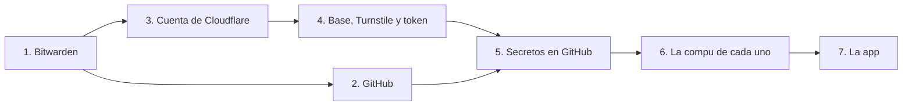

# Entorno: cuentas, accesos y configuración

> Guía paso a paso de las cuentas, los accesos y los secretos para poner en marcha el Club de una cafetería: gestor de contraseñas, GitHub, Cloudflare y la compu de cada uno. Se hace una vez por cafetería. Donde dice `club`, va el nombre que elijas para esa cafetería (por ejemplo `club-mi-cafeteria` si hay varias en la misma cuenta).

## Lo decidido que usa esta guía

| Tema | Decisión |
|---|---|
| Alojamiento | Cloudflare: Workers + D1 con jurisdicción UE + Turnstile + DNS ([cloudflare.md](cloudflare.md)) |
| Plan de Cloudflare | **Gratis** para empezar. Se revisa antes del lanzamiento |
| Proteger `main` | **Acuerdo de trabajo, gratis**. Producción solo se publica desde la CI |
| Gestor de contraseñas | Bitwarden, organización gratis para el equipo de desarrollo |
| Repo | Una copia de la marca blanca por cafetería, en la cuenta de quien desarrolla, con el resto del equipo como colaboradores |
| Framework | React Router 7 ([stack.md](stack.md)) |

## En qué orden



Bitwarden va primero: cada contraseña, token o clave que aparece en los pasos siguientes se guarda ahí en el momento.

---

## 1. Bitwarden

**Cada uno**
1. Crear la cuenta personal en bitwarden.com con su mail personal.
2. Elegir una contraseña maestra larga (una frase de 4 o 5 palabras). **No se puede recuperar**: si se olvida, se pierde la bóveda.
3. Activar la verificación en dos pasos con una app (Aegis, Google Authenticator, 2FAS).
4. Guardar el **código de recuperación de la verificación en dos pasos** en papel, en casa.
5. Instalar la extensión del navegador y la app del celular.

**Una vez (quien administra)**
1. Crear la organización del equipo (plan gratis).
2. Invitar al resto del equipo. Cuando acepten, **confirmarlos** (Bitwarden pide ese segundo paso).
3. Crear las colecciones:

| Colección | Qué guarda |
|---|---|
| **<Cafetería> · producción** | Lo que, si se pierde o se filtra, afecta a la cafetería |
| **<Cafetería> · desarrollo** | Lo de pruebas y vistas previas |

### Qué se guarda y cómo se llama

Un ítem por secreto, con el nombre igual al de la variable, así se encuentra sin pensar.

| Ítem | Colección | Qué es | Cuándo se crea |
|---|---|---|---|
| `Cloudflare · cuenta <Cafetería>` | Producción | Usuario y contraseña de la cuenta, si se crea una propia (paso 3) | Paso 3 |
| `DNI_HMAC_KEY · producción` | Producción | **La clave del hash del DNI.** La crítica | Paso 5, antes del lanzamiento |
| `PIN_HMAC_KEY · producción` | Producción | Clave del hash del PIN del equipo. Si se pierde, se crea otra y se vuelven a cargar los PIN | Antes del lanzamiento |
| `CUSTOMER_SESSION_KEY · producción`, `STAFF_SESSION_KEY · producción` | Producción | Claves para firmar las sesiones. Si se pierden o se filtran, se crean otras: los clientes (o el equipo) vuelven a entrar | Antes del lanzamiento |
| `TURNSTILE_SECRET_KEY · producción` | Producción | Clave secreta de Turnstile | Paso 4 |
| `CLOUDFLARE_API_TOKEN · GitHub Actions` | Producción | Token para publicar desde la CI | Paso 4 |
| `CLOUDFLARE_ACCOUNT_ID` | Producción | Número de la cuenta (no es secreto, pero conviene tenerlo a mano) | Paso 3 |
| `Dominio · acceso` | Producción | Acceso al registro del dominio (y a nic.ar, si se usa) | Cuando se compre |
| `DNI_HMAC_KEY · dev` | Desarrollo | Clave del hash para la base de prueba. **Distinta** de la de producción | Paso 5 |
| `Caja · PIN del equipo` | Producción | El PIN de cada gerente. El de los baristas no se guarda: lo arma la app y se lo pasa el gerente (*Equipo*) | Al lanzar |

En la nota de cada ítem: **para qué es, dónde se usa y cómo se rota**. Ejemplo: *Token de Cloudflare para publicar. Está en Settings → Secrets de GitHub. Si se filtra: borrarlo en Cloudflare, crear otro igual y reemplazarlo en GitHub.*

---

## 2. GitHub

**Cada uno**
- Verificación en dos pasos activada (GitHub ya la exige).
- En la compu, Git con su nombre y su mail (ver paso 6).

**En el repo (quien es dueño)** · *Settings*

| Dónde | Qué | Por qué |
|---|---|---|
| *General → Default branch* | Cambiar a **`dev`** | Los pull requests nuevos van contra `dev` sin tener que elegirlo |
| *General → Pull Requests* | Tildar ***Allow squash merging*** y ***Allow merge commits***; destildar *rebase merging* | Squash de tu rama a `dev`; *merge commit* de `dev` a `main`, para que las dos ramas compartan historia ([CONTRIBUTING.md](../../CONTRIBUTING.md)) |
| *General → Pull Requests* | En *squash merging*, elegir *Default to pull request title* | El commit lleva el título del pull request, que ya está en español |
| *General → Pull Requests* | Tildar ***Automatically delete head branches*** | Las ramas se borran al fusionar, sin acordarse |
| *General → Pull Requests* | Tildar *Always suggest updating pull request branches* | Avisa cuando una rama quedó atrás de `main` |
| *General → Features* | Destildar *Wikis* y *Projects* si no se usan | Menos lugares donde buscar. La documentación vive en el repo |
| *Collaborators* | El resto del equipo con rol *Write* | Puede abrir ramas y pull requests |
| *Code security* | Activar ***Dependabot alerts*** y ***Dependabot security updates*** | Avisos de seguridad de las dependencias, gratis en repos privados |
| *Actions → General* | *Workflow permissions*: **Read repository contents** | Las acciones tienen el mínimo permiso; se amplía en cada archivo de CI si hace falta |
| *Branches* | **Nada**: en un repo privado gratis las reglas no son obligatorias | Acordado: proteger `dev` y `main` por acuerdo ([ci-cd.md](ci-cd.md)) |

**El acuerdo, en una línea:** nadie sube directo a `dev` ni a `main`; todo entra por pull request con la CI verde y el visto bueno del otro.

**Notificaciones:** cada uno, en *Watch* del repo, elegir *Participating and @mentions* + *Pull requests*, así le llega cuando el otro le pide revisión.

**Secretos de Actions:** se cargan en el paso 5. En un repo privado gratis no hay *environments* con secretos propios: se usan los del repositorio.

---

## 3. La cuenta de Cloudflare

### De quién es la cuenta

**Recomendado: una cuenta de Cloudflare propia de la cafetería (o del producto), con el equipo como miembros.**

Por qué no una cuenta personal: los límites del plan gratis se compartirían con cualquier otro proyecto suyo (un error en bucle en otro lado podría cortar la caja), y si un día se entrega el proyecto, hay que mudar cada pieza.

**Cómo se crea**
1. Quien administra crea la cuenta con un mail del proyecto. Puede ser un alias de su mail (`nombre+club@…`); si Cloudflare no lo acepta, un mail nuevo del proyecto. Guardar el acceso en Bitwarden (`Cloudflare · cuenta <Cafetería>`) y activar la verificación en dos pasos.
2. Desde esa cuenta, en *Manage account → Members*, invitar a los **usuarios personales** del equipo como ***Super Administrator***. Todos tienen que tener la verificación en dos pasos.
3. A partir de ahí, cada uno entra con su usuario y elige la cuenta de la cafetería. El usuario del alias queda solo como respaldo.
4. Ponerle a la cuenta el nombre de la cafetería (*Manage account → Configurations*) y anotar el *Account ID* en Bitwarden.

### ¿Y si le damos acceso al dueño de la cafetería?

Lo que podría ver y hacer depende del rol que se le dé.

| Qué hay en Cloudflare | ¿Lo vería? | Detalle |
|---|---|---|
| **El código fuente** (el repo, las pruebas, el historial) | **No** | Vive en GitHub, no en Cloudflare |
| La app ya compilada | **Sí**, con un rol de administrador o de Workers | Cloudflare guarda lo publicado: un archivo de JavaScript compilado. Se puede leer y descargar, pero no es el proyecto: sin pruebas, sin historial, sin forma cómoda de seguir desarrollándolo |
| Las claves secretas (DNI, Turnstile) | **No** | Nadie puede volver a ver un secreto después de guardarlo, ni ustedes. Por eso la copia en Bitwarden |
| Los datos de los clientes (D1) | **Sí**, con un rol de administrador | Puede consultarlos y exportarlos. En el modelo A los datos son de la cafetería, así que no es un problema de propiedad, pero sí de **riesgo**: un cambio o un borrado por error |
| El dominio y los DNS | **Sí**, con un rol de administrador o de dominio | Un cambio de DNS por error deja la app sin dirección |
| Borrar o cambiar cosas | **Sí**, salvo que el rol sea de solo lectura | — |

**Propuesta: no darle acceso a Cloudflare.** En el modelo A ustedes operan todo ([entrega.md](entrega.md)), y lo que necesita la cafetería lo tiene por otros caminos:

| Lo que necesita el dueño | Cómo lo tiene |
|---|---|
| Ver cómo va el Club (clientes, sellos, premios) | En el **panel del gerente** de la app |
| Tener sus datos | **Exportación mensual** de la base, que se le puede mandar |
| No depender de ustedes para la clave del DNI | **La copia en papel**, guardada por la cafetería |
| Que el dominio sea suyo | Titular a su nombre ([dominio.md](dominio.md)) |
| Si la relación termina | El plan de salida de [entrega.md](entrega.md): datos, clave y dominio, con aviso y transición |

Si igual quiere entrar, el rol mínimo es ***Administrator Read Only***: ve todo, no cambia nada. Ve los datos y la app compilada, no el código fuente.

### Configuración de la cuenta

| Dónde | Qué |
|---|---|
| *Workers & Pages → Plans* | Plan **Free**. No cargar tarjeta mientras sea gratis |
| *Workers & Pages* (primera vez) | Subdominio `workers.dev` de la cuenta, por ejemplo **`<cuenta>`**. Queda `….<cuenta>.workers.dev`. Sirve hasta tener dominio y se puede cambiar |
| *Notifications* | Revisar las alertas disponibles y activar las de la cuenta y de seguridad, al mail del equipo |
| *Audit log* | Nada que configurar: ahí queda quién cambió qué |

---

## 4. Base, Turnstile y token

### Nombres

Pensados para varias cafeterías ([varias-cafeterias.md](varias-cafeterias.md)): **la cafetería primero, después el entorno.**

| Pieza | prod | dev |
|---|---|---|
| App (Worker) | `club` | `club-dev` |
| Base (D1) | `club-prod` | `club-dev` |
| Turnstile | widget `club` | El mismo widget, con las direcciones de prueba |
| Dirección | El dominio de la cafetería (cuando lo haya) · `club.<cuenta>.workers.dev` hasta entonces | `club-dev.<cuenta>.workers.dev` |

Los Workers se crean solos con la primera publicación: no hace falta crearlos a mano.

### Las dos bases, con jurisdicción UE

**La jurisdicción se elige al crear la base y no se puede cambiar después** ([cloudflare.md](cloudflare.md), *Datos personales*). Las dos en UE, para que la prueba se parezca a producción.

Desde el panel: *Storage & databases → D1 → Create* → nombre → *Data location* → ***Jurisdiction: European Union (EU)***.

O desde la terminal:

```sh
npx wrangler d1 create club-prod --jurisdiction eu
npx wrangler d1 create club-dev --jurisdiction eu
```

Anotar el *Database ID* de cada una: va en `wrangler.jsonc` cuando exista la app (no es secreto).

### Turnstile

*Turnstile → Add widget*:
- Nombre: `club`.
- Direcciones (*hostnames*): `club.<cuenta>.workers.dev`, `club-dev.<cuenta>.workers.dev` y, cuando exista, el dominio de la cafetería.
- Modo: ***Managed*** (casi nunca le pide nada a la persona).
- Guardar la **clave secreta** en Bitwarden. La clave del sitio no es secreta: va en el código.
- **Creado** (05/10/2026). Clave del sitio: `0x4AAAAAAFOrVikMxHk_6Nys`.

En la compu se usan las **claves de prueba** de Cloudflare (ya están en [`.dev.vars.example`](../../app/.dev.vars.example)): siempre dejan pasar y no gastan nada.

### Token para publicar desde GitHub

*Manage account → Account API tokens → Create token* (token **de la cuenta**, no de un usuario: si alguien del equipo se va, sigue funcionando).

| Campo | Valor |
|---|---|
| Nombre | `GitHub Actions · publicar` |
| Plantilla | *Edit Cloudflare Workers* |
| Permisos a sumar | *Account → D1 → Edit* (para las migraciones) |
| Recursos | Solo la cuenta de la cafetería; las zonas, solo el dominio cuando exista |
| Vencimiento | Un año, con recordatorio para renovarlo |

Guardar el token en Bitwarden en el momento: Cloudflare lo muestra una sola vez.

---

## 5. Secretos

### En GitHub (*Settings → Secrets and variables → Actions*)

| Nombre | Tipo | Valor |
|---|---|---|
| `CLOUDFLARE_API_TOKEN` | *Secret* | El token del paso 4 |
| `CLOUDFLARE_ACCOUNT_ID` | *Variable* (no es secreto) | El *Account ID* |

**Nada más va en GitHub.** La clave del DNI y la de Turnstile viven en Cloudflare.

### En Cloudflare (por Worker)

Se cargan **después de la primera publicación**, cuando los Workers ya existen.

| Secreto | `club` (producción) | `club-dev` |
|---|---|---|
| `DNI_HMAC_KEY` | La de producción | **Otra**, solo de prueba |
| `PIN_HMAC_KEY` | La de producción | **Otra**, solo de prueba |
| `CUSTOMER_SESSION_KEY`, `STAFF_SESSION_KEY` | Las de producción | **Otras**, solo de prueba |
| `TURNSTILE_SECRET_KEY` | La del widget | La del widget |

Cómo generar una clave del DNI (32 bytes al azar):

```sh
openssl rand -base64 32
```

Cómo cargarla sin que quede en el historial de la terminal (la pide al ejecutar):

```sh
# Desde app/. Prod:
npx wrangler secret put DNI_HMAC_KEY -c wrangler.jsonc
# Dev:
npx wrangler secret put DNI_HMAC_KEY --env dev -c wrangler.jsonc
```

**La clave del DNI de producción:**
1. Se genera **una sola vez**, antes del lanzamiento, cuando la base real arranca vacía.
2. Se guarda en Bitwarden **antes** de cargarla en Cloudflare.
3. Se imprime y se entrega en sobre cerrado a la cafetería.
4. **No se cambia nunca** con clientes anotados: cambiarla obliga a todos a anotarse de nuevo.

**Antes del primer despliegue:** cargar los secretos en `club-dev` y en `club`. Sin ellos, la app responde con error.

### Las cuentas del equipo de la caja

Las crea quien administra, desde `app/`. Nunca la CI ni Claude.

| Comando | Qué hace |
|---|---|
| `npm run staff:create` | Una persona nueva: email (con el que entra; único), nombre (solo letras), rol (barista o gerente) y PIN. Para los gerentes: a los baristas los da de alta el gerente desde *Equipo* (`/register/team`) |
| `npm run staff:change-pin` | Un PIN nuevo para alguien que ya existe, buscada por email (en dev y prod, te da la consulta para sacar su id). También la destraba y le cierra las sesiones abiertas. Es la forma de cambiarle el PIN al gerente |

- Los dos piden el PIN dos veces, sin mostrarlo, y no aceptan PIN fáciles (`123456`, `000000`…).
- En **local** lo hacen en la base de la compu, con la clave de `.dev.vars`.
- En **dev o prod** piden la `PIN_HMAC_KEY` de ese ambiente (Bitwarden) y muestran el comando de `wrangler` para correrlo.
- El PIN se le pasa a la persona en mano y se guarda en Bitwarden (*Caja · PIN del equipo*).
- A una persona con sellos o canjes no se la puede borrar: queda en el historial de quién hizo qué.

**Destrabar** a alguien antes de los 15 minutos, sin cambiarle el PIN (con `--env dev` para dev):

```sh
npx wrangler d1 execute DB --remote -c wrangler.jsonc --command "UPDATE staff SET failed_attempts = 0, locked_until = NULL WHERE email = 'ana@example.com'"
```

---

## 6. La compu de cada uno

**Para desarrollar no hace falta ninguna cuenta ni clave:** alcanza con Node, Git y `npm run setup` (ver *Levantar el proyecto* en el [README](../../README.md)). Lo de abajo es lo que conviene dejar configurado una vez.

| Qué | Cómo |
|---|---|
| **Node** | La versión del archivo [`.nvmrc`](../../.nvmrc) (Node 24, LTS). Con `nvm` o `fnm`: `nvm use` en la carpeta del repo |
| **Git** | `git config --global user.name "Nombre Apellido"` y `git config --global user.email` con el mail de GitHub |
| **Editor** | El que prefiera cada uno, con soporte de [`.editorconfig`](../../.editorconfig) (VS Code lo trae con una extensión). Cuando haya código, la extensión de Biome |
| **Wrangler** | No se instala aparte: viene con el proyecto y se usa con `npx wrangler` |
| **Entrar a Cloudflare desde la terminal** | Solo para administrar (ver bases, cargar secretos): `npx wrangler login` con el usuario personal y elegir la cuenta de la cafetería. Para desarrollar no hace falta |
| **Secretos locales** | Los copia `npm run setup` de [`.dev.vars.example`](../../app/.dev.vars.example) a `.dev.vars` (Git lo ignora). Son claves de prueba |

**Nunca** van en `.dev.vars` las claves de producción.

---

## Lista para tachar

**Bitwarden**
- [ ] Cuenta de cada uno, con verificación en dos pasos y código de recuperación en papel.
- [ ] Organización del equipo con las dos colecciones de la cafetería.
- [ ] Todo el equipo invitado y confirmado.

**GitHub**
- [ ] Repo de la cafetería, copiado de la marca blanca.
- [ ] *Squash merging* con el título del pull request.
- [ ] Tildar también *Allow merge commits* (para `dev` → `main`).
- [ ] Rama `dev` creada y elegida como *Default branch*.
- [ ] Borrar ramas al fusionar.
- [ ] Dependabot: alertas y arreglos de seguridad.
- [ ] Permisos de Actions en solo lectura.

**Cloudflare**
- [ ] Cuenta creada, con verificación en dos pasos y el nombre de la cafetería.
- [ ] El equipo como *Super Administrator* con su usuario personal.
- [ ] Subdominio `workers.dev` elegido.
- [ ] Bases `club-prod` y `club-dev`, **las dos con jurisdicción UE**, y sus ID en [`app/wrangler.jsonc`](../../app/wrangler.jsonc).
- [ ] Widget de Turnstile, su clave pública en `wrangler.jsonc` y la secreta en Bitwarden.
- [ ] Token de la cuenta para GitHub Actions, en Bitwarden y en GitHub. Anotar cuándo vence.
- [ ] *Account ID* en Bitwarden y como variable de GitHub.
- [ ] Secretos cargados en `club-dev` y `club` (paso 5).
- [ ] Apagar `workers_dev` en prod cuando haya dominio.

**Cada compu**
- [ ] Node 24, Git con nombre y mail, `wrangler login`, `.dev.vars` copiado.

## Fuentes

- [Roles de miembros de Cloudflare](https://developers.cloudflare.com/fundamentals/manage-members/roles/) · [Alcance de los roles](https://developers.cloudflare.com/fundamentals/manage-members/scope/)
- [Secretos de Workers: no se pueden volver a ver](https://developers.cloudflare.com/workers/configuration/secrets/)
- [Jurisdicción de datos de D1](https://developers.cloudflare.com/d1/configuration/data-location/)
