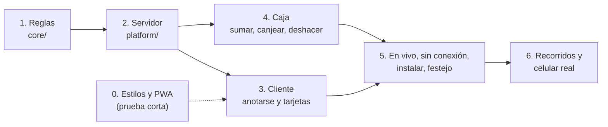

# Plan de la primera salida

> Historia de cómo se construyó la primera versión, en etapas chicas (con la primera cafetería; hoy su configuración es la de ejemplo, `cafes/example.ts`). Sirve para entender por qué el código es como es. Para vestir la app para una cafetería, ver la [puesta en marcha](../../marca/README.md). Fecha: 06/10/2026. Cómo llegar del esqueleto actual a la primera salida, en etapas chicas. Base: [spec](../propuestas-tarjeta-fidelizacion.md), [flujos del cliente](../flujos-cliente.md), [flujos del equipo](../flujos-equipo.md), [arquitectura.md](arquitectura.md) y [stack.md](stack.md).

## Avance

| Etapa | Pull request |
|---|---|
| 1 · Reglas | #5 |
| 2a · Base de datos | #6 |
| 2b · Seguridad | #7 |
| 3 · Cliente | #8 |
| 4a · Caja: entrar y salir | #12 |
| 4b · Caja: buscar, sumar, canjear y deshacer | #13 |
| 4c · Caja: la cámara | #14 |
| Equipo: el gerente da de alta a los baristas (fase 2, adelantado) | #16 |
| 5a · La app guardada en el celular: manifiesto, ícono y sin conexión | — |

## Qué entra

| Lado | Entra | Queda para después |
|---|---|---|
| Cliente | Bienvenida con documento, confirmar documento, nombre y consentimiento, guardar en el celular (Android, iPhone, otro navegador), las 3 tarjetas, el código de cada una, sello en vivo, festejo, premio canjeado, sin conexión, *Salir* | Avisos ("Hoy 2x1") |
| Caja | Ingresar con email y PIN, escanear, tipear el código corto, tarjeta escaneada, *Sumar sello*, *Canjear premio*, *Deshacer*, sin conexión, permiso de cámara | Buscar por documento o nombre (Flujo D), panel (Flujo F), borrar desde la app (Flujo G), sumar a mano |

Las pantallas sin wireframe (bienvenida, alta, guía de instalación, festejo, ingresar de la caja) se arman directo en código siguiendo los flujos y la marca, y se revisan con las skills **revisar-pantalla** y **voz**.

## Cómo se trabaja

- **La prueba primero**, según la skill `pruebas`: cada regla del spec, una prueba que falla antes del código.
- **Un pull request por paso**, contra `dev`. Cada etapa son uno o más pull requests; ninguno mezcla dos etapas.
- Al terminar cada etapa, probarla en un celular real en dev.
- Lo que se decida en el camino se anota en [README.md](README.md), *Decisiones*.

## Etapa 0 · Preparar

| Qué | Detalle |
|---|---|
| `tokens.css` | `npm run tokens` lo genera desde [`tokens.json`](../../marca/tokens.json) en `src/styles/`. Se sube al repo y una prueba revisa que esté al día. **Hecho con la etapa 3** |
| Prueba corta de la PWA | Medio día: `vite-plugin-pwa` con React Router 7 en modo servidor no es un caso oficial. Probar que una página guardada se abra sin conexión. **Decidido (06/10/2026):** si no anda, se escribe un *service worker* propio y corto (`public/sw.js`). **Hecho con la 5a** (09/10/2026): propio, en `src/web/sw/` ([arquitectura.md](arquitectura.md#la-app-sin-conexión)) |
| Datos inventados | `npm run db:seed` (`scripts/seed.mjs`): *Marta García, 30.123.456* con sus 3 tarjetas y *Ana · barista*. Es un script y no un `seed.sql` porque calcula los HMAC con las claves de `.dev.vars`. **Hecho con la etapa 4a** |

**Listo cuando:** los estilos salen de los tokens y se sabe cómo se va a hacer la PWA.

## Etapa 1 · Las reglas (`core/`)

Funciones puras, sin base ni React. Pruebas de la capa 1.

| Archivo | Qué hace | Pruebas principales |
|---|---|---|
| `cafes/example.ts` | Las 3 tarjetas: tipo, nombre, sellos (7, 4, 4), premio, sello, textos | Que estén las 3, en el orden fijo |
| `core/card.ts` | El estado desde los movimientos: sellos de la vuelta, premios disponibles. Qué movimiento produce *Sumar sello* y *Canjear premio*, y si se puede deshacer | Completa a los 7 y a los 4 y vuelve a 0 · los premios se acumulan · canjear no suma · deshacer un sello y un canje · un movimiento deshecho no cuenta · sin premios no se canjea |
| `core/document.ts` | Formato del DNI y de otro documento; mostrarlo con puntos | Pocos dígitos, letras y puntos: rechazado con su mensaje |
| `core/codes.ts` | El alfabeto del código corto (sin 0/O, 1/I/L) y cómo se agrupa para dictarlo (*K7 4QM*) | Normalizar lo que tipea el barista (minúsculas, espacios) |
| `core/greeting.ts` | *Buenos días*, *Buenas tardes*, *Buenas noches* | 12:59, 13:00, 19:59, 20:00 |
| `core/staffPin.ts` | PIN de 6 números y PIN fácil | `123456`, `000000`, `111111`, `654321` rechazados |

**El cálculo del libro mayor:** con los movimientos no deshechos, `sellos de la vuelta = sellos mod N` y `premios = ⌊sellos / N⌋ − canjes`.

**Decidido (06/10/2026):** un sello que completó la tarjeta **no se puede deshacer si su premio ya se canjeó** (con la fórmula, los premios quedarían en −1). La caja explica que primero hay que deshacer el canje. Tiene su prueba.

**Listo cuando:** cada regla del spec tiene su prueba y pasa.

## Etapa 2 · El servidor (`platform/`)

En dos pull requests: **2a**, la base (esquema, migración, D1 de prueba y fábricas), y **2b**, la seguridad (secretos, HMAC, sesiones, Turnstile, intentos, códigos, registro y cuentas del equipo).

| Qué | Detalle |
|---|---|
| Esquema y primera migración | Drizzle: `customers`, `cards`, `entries`, `staff` (antes `clientes`, `tarjetas`, `movimientos`, `equipo`; migración 0004) ([arquitectura.md](arquitectura.md)), con `npm run db:generate` (2a) |
| Secretos | `secrets.server.ts` frena con un error claro si falta `DNI_HMAC_KEY`, `PIN_HMAC_KEY`, `CUSTOMER_SESSION_KEY`, `STAFF_SESSION_KEY` o `TURNSTILE_SECRET_KEY`. El tipo `Env` de la CI no los trae (no hay `.dev.vars`), así que se leen con esa validación y no como `env.DNI_HMAC_KEY`. Cuando estén cargados en los dos Workers, conviene sumar `secrets.required` a `wrangler.jsonc`: los tipos quedan iguales en la CI y **no se publica si falta uno** |
| DNI y PIN | HMAC con Web Crypto; comparación en tiempo constante |
| Sesiones | Cookie firmada `__Host-`, `HttpOnly`, `Secure`, `SameSite=Lax`, sin tabla ([arquitectura.md](arquitectura.md#las-sesiones)). Cliente 12 meses, equipo configurable; se renuevan al usarse. El equipo queda afuera con `deactivated_at` o si le cambian el PIN |
| Turnstile | Validación en el servidor. En la compu y en las pruebas, la clave de prueba que siempre deja pasar |
| Intentos | DNI: tope por conexión con el *Rate Limiting* de Workers. PIN: 5 fallidos, 15 minutos, en la tabla `staff` |
| Códigos | El del QR (largo, al azar) y el corto (6 caracteres), únicos, al crear las 3 tarjetas |
| Registro | `log.server.ts`, que tacha el DNI y el nombre. **Ojo:** los errores de Drizzle traen los parámetros de la consulta en el mensaje (el nombre del cliente, por ejemplo); se registran sin ellos, y el `handleError` de React Router pasa por acá en vez de `console.error` |
| Cuentas del equipo | `npm run staff:create` y `npm run staff:change-pin` (`scripts/staff.mjs`): piden email, nombre, rol y PIN, calculan el HMAC con la clave del ambiente y escriben el SQL. **Las crea quien administra**; nunca la CI ni Claude |

**Decidido (06/10/2026): las pruebas con D1 usan `getPlatformProxy` de Wrangler** con Vitest 5: una D1 local de verdad, sin bajar de versión. El pool de Workers para Vitest (`@cloudflare/vitest-pool-workers` 0.22) pide Vitest 4; se reconsidera si un día lo soporta.

**Pruebas (capa 2):** el DNI no aparece en ninguna columna después de anotarse · misma clave, mismo hash · sin Turnstile no hay alta ni ingreso · la sesión vence y se renueva · el PIN se bloquea al quinto intento.

**Listo cuando:** se puede anotar a alguien y sumarle un sello desde una prueba, contra una D1 local.

## Etapa 3 · El cliente

| Pantalla | Ruta | Notas |
|---|---|---|
| Bienvenida | `_index` | Campo de documento y Turnstile. Si ya existe, entra; si no, pasa a confirmar |
| Confirmar documento | `sign-up` | *¿Es correcto 30.123.456?* El documento viaja en el formulario, nunca en la dirección |
| Nombre y consentimiento | `sign-up` (segundo paso) | Crea el cliente, sus 3 tarjetas y la sesión. *Más información* con texto provisorio |
| Las 3 tarjetas | `_customer.cards._index` | Saludo según la hora, billetera, *Salir* con confirmación |
| El código | `_customer.cards.$type` | Nombre grande, QR, código corto agrupado y la ayuda |

**Decidido (06/10/2026):** el QR lleva solo el código largo, sin dirección web. Si un cliente lo escanea con la cámara de su celular, ve un texto y no pasa nada; la caja lo reconoce.

**Componentes:** tarjeta (cerrada y abierta), grilla de sellos (4 columnas, banda de premio para grano), pastilla de premio, QR (`uqr`, en SVG), botones, avisos.

**Listo cuando:** en un celular, Marta se anota, ve sus 3 tarjetas, abre el código, sale y vuelve a entrar con el mismo DNI.

**Cómo quedó:**
- La confirmación del documento es una hoja que sube sobre la bienvenida (la respuesta del formulario), así el número nunca pasa por la dirección. No hace falta `/entrar`. El wireframe la mostraba como pantalla aparte.
- El campo del DNI deja pasar solo números, hasta 8, y limpia los puntos de un número pegado. Si no carga JavaScript, el servidor rechaza lo mismo con su mensaje.
- Sin pantalla de *Listo*: después de *Anotarme* va directo a las tarjetas.
- La billetera se mueve como la del iPhone: la tarjeta que se toca baja y se descubre adelante, y la otra sube entera por detrás. Es CSS (posición, recorte y opacidad, 320ms con la curva de cajón); con menos movimiento, solo se funde el contenido. Cambiar de tarjeta no le pide nada al servidor (`shouldRevalidate`).
- El tope de intentos por conexión es de 30 por minuto: los clientes que se anotan en el local comparten el WiFi.
- *Más información* se abre en una hoja que sube desde abajo, sin salir del formulario, y se cierra con *Cerrar*. El texto es provisorio y no dice dónde se guardan los datos (se sacó el 06/10/2026; ver [datos-personales.md](datos-personales.md)).
- El botón de la tarjeta dice *Ver mi código* (`voz.md` y la guía del Club); el wireframe decía *Mostrar mi código*.
- Los textos propios de la cafetería (el nombre del Club, la bienvenida, quién guarda los datos) salen de `cafes/` (hoy, `cafes/example.ts`).

## Etapa 4 · La caja

| Pantalla | Ruta | Notas |
|---|---|---|
| Entrar | `register.sign-in` | Email (teclado de email) y PIN (teclado numérico) |
| Salir | `register.sign-out` | Cierra la sesión del equipo y vuelve a *Entrar* |
| Sumar sello | `register._staff._index` | Cámara arriba y campo *Buscar tarjeta* (solo el código corto). Arriba, *Juan · barista* y *Salir* |
| Tarjeta escaneada | `register._staff.card.$code` | Nombre, tarjeta, sellos y premios. *Sumar sello* y *Canjear premio* de 72px, apilados |
| Confirmación | `register._staff.done.$entry` | *Sello sumado*, *Tarjeta completa* o *Premio canjeado*, con *Deshacer* y *Escanear otra tarjeta* |
| Errores | En las mismas pantallas | QR que no es del Club, sin conexión, sin permiso de cámara |

- **Lector de QR:** `@yudiel/react-qr-scanner`, que lee con ZXing en WebAssembly en todos los celulares (decidido el 08/10/2026; ver *Cómo quedó la 4c*). Probarlo en el celular del gerente y en un Android barato antes de cerrar la etapa.
- **Sin conexión:** no se guarda nada para después; los botones explican por qué no responden.
- **El DNI nunca viaja** en ninguna respuesta de la caja: una prueba lo comprueba.

**Listo cuando:** en el celular del gerente se escanea la tarjeta de Marta, se suma, se deshace, se completa y se canjea, y cada acción queda a nombre de quien la hizo.

En tres pull requests: **4a** entrar y salir, **4b** buscar por código, sumar, canjear y deshacer, y **4c** la cámara.

**Cómo quedó la 4a** (07/10/2026):
- El PIN va en un campo de texto numérico que muestra puntos, no en uno de contraseña: así el celular no ofrece guardarlo y nadie entra con la cuenta del otro.
- Cada persona tipea su email. *Salir* no pide confirmación: cambiar de persona tiene que ser rápido.
- Sin Turnstile: el bloqueo por persona (5 PIN mal, 15 minutos) alcanza, y cambiar de persona pasa varias veces por día.
- La sesión dura 30 días sin usar: cada uso la renueva.
- `appFor(…).register()` devuelve la caja de quien entró, o nada: cada `loader` y `action` de la caja empieza ahí, y quién hizo cada cosa sale de la cookie, nunca del formulario.
- La pantalla *Entrar* no tiene wireframe: se armó en código con la marca y el Flujo A.

**Cómo quedó la 4b** (07/10/2026):
- *Buscar tarjeta* acepta el código corto (con minúsculas o el espacio de dictarlo) y también el código largo del QR. Las dos llevan a `/register/card/K7M2QX`: el código largo nunca va en la dirección.
- **Tocar dos veces o reintentar con mala señal nunca suma dos veces.** La tarjeta manda en el formulario la `version` que vio el barista y el servidor guarda solo si sigue igual. Si cambió y el único movimiento nuevo es de esa persona, era su toque anterior y se muestra su confirmación; si no, la tarjeta otra vez con un aviso.
- La confirmación es un comprobante: muestra la tarjeta como la dejó ese movimiento (`balanceAfter` en `core/card.ts`), aunque se recargue o se vuelva atrás. Un movimiento deshecho lleva a la confirmación de su deshacer.
- **Una tarjeta con premio** (08/10/2026): al abrirla salta solo el aviso *Marta tiene un premio · Si lo usa en esta compra, hacele el descuento.*, con *Canjear premio*, como el festejo del cliente. Desde el 09/10/2026 también tiene *Sumar sello*, en el aviso y en la tarjeta, para guardar el premio; un enlace chico vuelve a abrir el aviso. *Sumar sello* es directo.
- En la confirmación, *Deshacer* es un enlace chico junto al dato, lejos del pulgar; abajo queda solo *Escanear otra tarjeta* (08/10/2026).
- Sin conexión, la pantalla queda como estaba con *Sin conexión. No se puede sumar ni canjear hasta que vuelva.*, y volver a tocar es seguro. Nada se guarda para después.
- `findLedger` lee la tarjeta y sus movimientos en un solo viaje a la base (`batch`).
- Los recorridos 3 a 5 tipean el código corto; con la cámara, en la 4c.
- **Se adelantó de la etapa 5 el sello en vivo, en tiempo real** (decidido el 07/10/2026): mientras el cliente tiene el código abierto, ve el sello que se imprime, el festejo al completar y *Premio canjeado*, sin tocar nada. Los recorridos 3 a 5 ya no recargan la pantalla del cliente.

**Cómo quedó la 4c** (08/10/2026):
- **El lector es `@yudiel/react-qr-scanner`**, que maneja la cámara y lee con `barcode-detector` y ZXing en WebAssembly. Se descartó `qr-scanner`, sin cambios desde 2022. Se eligió frente a usar `barcode-detector` solo porque ya resuelve lo que más falla en celulares viejos o baratos: la cámara que tarda, que está ocupada o que no tiene la resolución pedida.
- **Lee siempre con ZXing, también en Android.** El lector propio de Chrome necesita Google Play Services, y hay celulares sin él (o con él desactualizado) donde Chrome dice que lo tiene pero no lee. El iPhone no trae lector: Safari lo tiene apagado.
- El archivo de ZXing (`zxing_reader.wasm`, 1 MB) lo sirve la app, no jsDelivr. Se descarga solo en *Sumar sello*: el resto de la app no lo carga. Las pruebas de la cámara bloquean jsDelivr para comprobarlo.
- Lee solo QR, suena al leer y no tiene botones propios (ni linterna ni zoom). La linterna queda para después, si hace falta.
- **Escanear suma el sello solo** (decidido el 08/10/2026; antes abría la tarjeta). Manda el código largo por POST al mismo formulario de *Buscar tarjeta*, marcado `from=camera`, y el caso de uso `stampScannedCard` suma y lleva a la confirmación. Si la tarjeta tiene un premio, no suma y la abre con su aviso. Si ninguna tarjeta tiene ese código, dice *Pedile al cliente el código de su tarjeta y escribilo.* y no pone el código largo en el campo.
- Una lectura suma un solo sello: al sumar, la pantalla cambia y la cámara se apaga. Si el mismo QR llega dos veces a la vez, la segunda muestra la confirmación de la primera. Lo que no se cubre: si la respuesta se pierde por mala señal y el barista vuelve a escanear, suma otro; se arregla con *Deshacer*.
- Un QR que no es del Club se reconoce en el celular (`readCardCode`), sin preguntarle al servidor, y la cámara sigue leyendo.
- **La cámara arranca apagada** (08/10/2026): el visor muestra el grabado de granos de la tarjeta take-away y *Tocá para escanear*. Se prende recién al tocarlo, así no queda encendida todo el día. El celular pide el permiso en ese momento.
- La cámara se apaga mientras busca la tarjeta, al salir de la pantalla y con el celular bloqueado o en otra app.
- Sin permiso, el visor apagado vuelve con un aviso que dice cómo darlo, y el campo sigue abajo. Tocar el visor otra vez vuelve a pedir la cámara: si el celular la tiene bloqueada, no pregunta y el aviso explica cómo habilitarla. Si el celular no tiene cámara o no hay HTTPS, queda solo el campo. Sin JavaScript, igual que en la 4b.
- **La cámara pide HTTPS:** en la compu anda en `localhost`, pero un celular conectado por WiFi a la compu no la abre. La prueba en el celular real se hace en dev.
- **Se adelantó la búsqueda por documento y nombre** (Flujo D, 08/10/2026). `searchCards` reemplaza a `findCard`. El nombre se guarda también en minúsculas y sin tildes (`customers.name_search`, migración 0006, que completa a los clientes que ya existen). Los resultados muestran cada cliente con su fecha de alta y sus 3 tarjetas, cada una con *Sumar sello* (o *Canjear premio*, que abre la tarjeta); con resultados en pantalla, la cámara se oculta.
- En el recorrido 3, Playwright reemplaza la cámara por un video del QR que muestra la pantalla del cliente; el lector real lo lee y el sello se suma solo. Los recorridos 4 y 5 siguen tipeando el código, que es más rápido.

## Equipo (fase 2, adelantado el 08/10/2026)

El gerente da de alta a los baristas y los maneja desde la caja ([Flujo H](../flujos-equipo.md)). Es la primera acción solo del gerente, así que con ella se construyó `core/access.ts` (decisión 2d).

- `/register/team`, con el enlace *Equipo* en el menú del nombre, solo para el gerente.
- Agregar barista: email y nombre; la app arma el PIN y lo muestra una sola vez.
- Por persona: nombre y email, PIN nuevo (cierra sus sesiones y la destraba), dar de baja y volver a activar, con su historial.
- Los gerentes, y el PIN del gerente, siguen con `npm run staff:create` y `npm run staff:change-pin`.
- Migración `0007`: la tabla `staff_audit`, con quién cambió a cada persona, qué y cuándo.
- Cada persona tiene su celular (08/10/2026): no se pide el PIN del gerente para entrar a *Equipo*.

## Etapa 5 · Lo que hace sentir que es una app

| Qué | Detalle |
|---|---|
| Sello en vivo | **Hecho con la 4b** (07/10/2026), en tiempo real: un Durable Object por tarjeta y un WebSocket mientras el código está abierto. Al cambiar, el sello se "imprime" (240ms) |
| Festejo | **Hecho con la 4b**: una hoja con el sello de premio (480ms) y el texto de la tarjeta. Usa el sello de premio de cada tarjeta hasta que estén los dibujos de festejo (`-premio-listo`) de ¼ kg y ½ kg |
| Premio canjeado | **Hecho con la 4b**: en vivo, en la pantalla del código, con el texto de la tarjeta |
| Sin conexión | **Hecho con la 5a** (09/10/2026): el código de cada tarjeta se muestra igual, también el de una que nunca se abrió y al abrir la app sin conexión, con *Sin conexión. Tus sellos se actualizan cuando vuelva.* Al volver, se pone al día solo |
| Guardar en el celular | Android (cartel del sistema), iPhone (3 pasos con el botón Compartir de Apple), otro navegador. Recordatorio discreto en las tarjetas. **Va en la 5b** |
| Manifiesto e ícono | **Hecho con la 5a**: fondo `tarjeta-1` con el símbolo de la cafetería en claro al 74%, y al 56% cuando Android lo recorta (10/10/2026; `npm run icons`, desde `public/brand/symbol-light.svg`); `theme-color` del `fondo` del tema, y `color-scheme: only light` para que ningún navegador oscurezca la app en un celular en modo oscuro (23/10/2026). Abre en `/cards`. Las pantallas de la caja no lo ofrecen |
| Movimiento | Según [movimiento.md](../../marca/movimiento.md), con la versión reducida. La billetera ya lo tiene desde la etapa 3 |

**Listo cuando:** con el código abierto en un celular y la caja en otro, el sello aparece solo; y en modo avión el código se sigue viendo.

## Etapa 6 · Cerrar la primera salida

- **Playwright** a 360 × 740 con los 6 recorridos de la skill `pruebas` y una pasada de axe por pantalla. *Adelantado el 07/10/2026:* `npm run test:e2e` ya corre en la CI con los recorridos 1 y 2 y las pantallas del cliente; cada etapa suma los suyos.
- **Chequeo después de publicar:** un pedido a dev y a prod en la CI.
- **En un celular real:** iPhone y Android, del lado del cliente y de la caja.
- **Antes de pasar a prod:** la clave del DNI de producción (Bitwarden y papel), los secretos cargados, las cuentas del equipo creadas, el texto de *Más información* definitivo y la base inscripta en la AAIP.

## Reparto entre los dos

Las etapas 1 y 2 conviene hacerlas juntas, o una persona y que la otra revise todo: son la base de lo demás. Desde la 3, una persona toma el cliente y la otra la caja; en la 5 se reparten por fila de la tabla.

## Decisiones del camino

| Etapa | Qué | Decisión (06/10/2026) |
|---|---|---|
| 0 | Cómo se hace la PWA | `vite-plugin-pwa`; si no anda, *service worker* propio. **Al final, propio** (09/10/2026): Workbox resuelve la página única de una SPA, y acá se guardan páginas del servidor de cada cliente |
| 1 | Deshacer un sello cuyo premio ya se canjeó | No se puede: primero se deshace el canje |
| 2 | Cómo se prueba con D1 | `getPlatformProxy` con Vitest 5 |
| 2 | Quién crea las cuentas del equipo | Quien administra, con el script |
| 3 | Qué lleva el QR | Solo el código largo, sin dirección web |
| 4 | Lector de QR | `@yudiel/react-qr-scanner` con ZXing en WebAssembly, con sonido (08/10/2026). A confirmar en el celular del gerente y en un Android barato |

## Lo que necesita del diseño

- Los sellos de festejo (`-premio-listo`) de ¼ kg y ½ kg, antes de la etapa 5.
- El texto de *Más información*, antes de pasar a prod (se arranca con uno provisorio).
